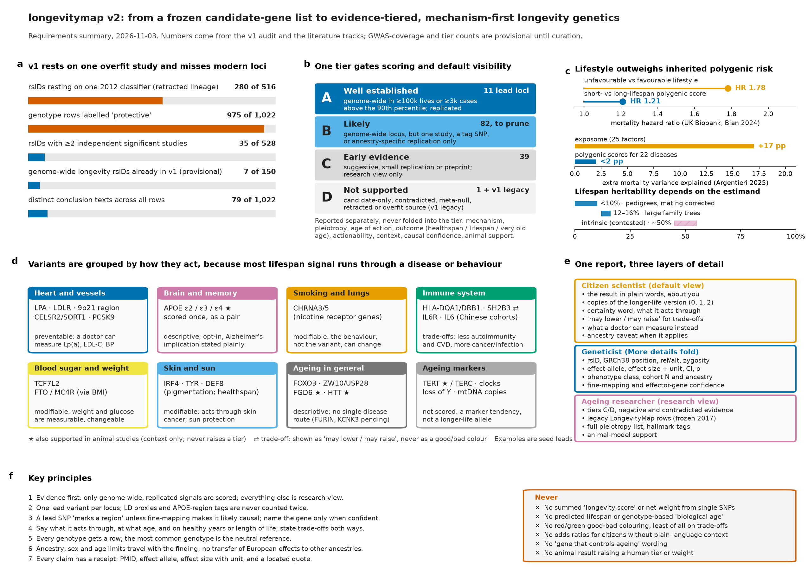

# longevitymap v2 — research and requirements

**Interactive report (tabbed):** [open rendered](https://htmlpreview.github.io/?https://github.com/dna-seq/just-dna-lite/blob/main/docs/longevitymap_v2/index.html) · [source](index.html)

The next version of the `longevitymap` annotation module is rebuilt around genome-wide, replicated evidence and organised by how each variant acts. Each scored locus carries seven axes, reported separately and never summed into a score:
1. evidence tier;
2. mechanism;
3. pleiotropy;
4. age of action;
5. outcome profile: healthspan, lifespan, exceptional survival;
6. actionability;
7. ancestry/sex context.

v1.2.0 (a port of HAGR LongevityMap, frozen since June 2017) is kept only as a legacy and negative-evidence layer.

## Contents

| File | What it is |
|---|---|
| [index.html](index.html) | Self-contained tabbed report: overview, why v2, v1 vs v2, tiers, axes, mechanism map, pleiotropy and age, definitions of pro-longevity, rare variants and animals, report design, filterable seed variants, build plan, sources |
| [longevitymap_v2_requirements.md](longevitymap_v2_requirements.md) | Full requirements: evidence model, data model on just-dna-format 0.7.1, voice rules, consumer and format change requests, decisions D1–D7, limits |
| [longevitymap_v1_vs_v2.md](longevitymap_v1_vs_v2.md) | Side-by-side comparison |
| [data/seed_variants.csv](data/seed_variants.csv) | 228 rsIDs in 161 loci merged from the literature tracks, with provisional tiers, pleiotropy labels, fine-mapping and animal support |
| [data/genage_crossref.csv](data/genage_crossref.csv), [data/v1_audit_profile.json](data/v1_audit_profile.json) | GenAge cross-reference; v1.2.0 audit numbers |
| [evidence/](evidence/) | Per-track syntheses, evidence tables and variant tables, tracks A–K (see below) |
| [figures/](figures/) | Infographic (PNG, PDF) and the age-of-action chart |
| [scripts/](scripts/) | uv project that rebuilds the seed list, figures and report (`uv sync`, then `uv run python build_report.py` from a working directory holding the inputs) |

**Literature tracks:**

| Track | Topic |
|---|---|
| A | LongevityMap/HAGR and the v1 audit |
| B | common-variant GWAS |
| C | rare and protective variants |
| D | healthspan, biological age and heritability |
| E | 2025–2026 preprints and papers |
| F | reporting to three audiences |
| G | SNP evaluation methodology |
| H | pleiotropy |
| I | conceptual and meta-reviews |
| J | mouse and model-organism validation |
| K | definitions of pro-longevity and age of action |

## How this was produced, and its limits

These are research notes and a design, not a curated module. They were produced on 2026-11-03 by AI agents (Claude, in a Claude Science session) working for the module author:
- literature tracks run as parallel sub-agents;
- PMIDs title-verified against PubMed;
- numbers recomputed from the v1 tables and the cited sources.

Tracks C and J were stopped by a content-safety filter on the first model and completed on a re-run with Sonnet 5.5, with the original briefs unchanged.

Treat as provisional until curation:
- GWAS-coverage counts;
- seed tiers;
- age-of-action classes;
- outcome profiles.

Most per-study facts were read at abstract level. The full list of limits is in the requirements, §12, and in the report's *Sources & limits* tab.
