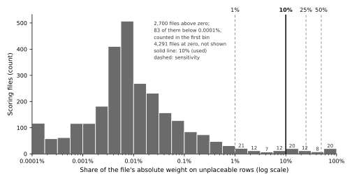

# Supplementary Table S5. PGS Catalog coverage of just-prs

PGS Catalog release of 2026-09-17 (6,991 scores), listed through the Catalog REST API (version 1.8.6) at 2026-10-10 20:12 UTC. Every score's harmonized scoring file for GRCh38 (`hmPOS_GRCh38`) was downloaded and read in full: 4,495,615,923 rows in 6,991 files, no sampling. The scoring engine described is just-prs 0.10.1.

## Method

just-prs computes every score as an additive sum: for each row, the dosage of the effect allele (0, 1 or 2 copies, counted against the VCF's REF and ALT) times the row's weight. Each row of each file is sorted into exactly one class, in this order:

1. **Unplaced**: no usable harmonized position (`hm_chr` or `hm_pos` empty), so the row joins no VCF record.
2. **Non-nucleotide**: placed, but the effect allele is not a string of A, C, G and T (HLA allele names, P/N, +/-, D/I, `<CN0>`, `<INS:ME:ALU>`, star alleles), so it never equals a VCF allele.
3. **Effect = other**: placed and nucleotide, but the effect allele equals the other allele, so the file does not say which allele carries the weight.
4. **Scored**: everything else. Scored rows flagged `is_dominant`, `is_recessive`, `is_interaction`, `is_diplotype` or `is_haplotype` are counted apart, because just-prs scores them as plain additive alleles.

Shares are of the file's total absolute weight (`|effect_weight|`; for a file with only per-dosage weights, the largest of `|dosage_0/1/2_weight|`, as just-prs's weight-mass coverage does), so the four shares of a file sum to 1. *Unplaceable* below is classes 1 and 2 together: rows that cannot be placed or matched. Weights are on each file's own scale, so shares are compared across files and weights never are. A row with no weight counts as zero weight, as it adds nothing to a just-prs score (3 rows in 2 files).

## Categories

- **Cannot be scored**: no row is left in class 4 with nonzero weight, so no result could follow the file.
- **Approximated**: the file can be scored, but meets at least one rule below; the share rules use a threshold of 10% of absolute weight.
- **As specified**: neither. A file in this category can still lose up to 10% of its weight to unplaceable rows; the threshold sensitivity table and the CSV give every file's share.

| Rule | Definition | just-prs code |
|---|---|---|
| Weight on rows that cannot be placed or matched | at least the threshold share of absolute weight sits on rows with no harmonized position, or whose effect allele is not an A/C/G/T string (HLA allele names, P/N, +/-, D/I, <CN0>, <INS:ME:ALU>, star alleles); those rows contribute nothing | `just_prs.prs._normalize_scoring_columns` (position from `hm_chr`/`hm_pos`), the variant-only left join in `just_prs.prs.compute_prs`, `just_prs.vcf.compute_dosage_expr` (effect allele compared with REF/ALT) |
| Dominant or recessive coding | some row has `is_dominant` or `is_recessive` true; the weight is applied per allele copy (additively) instead | `just_prs.scoring.SCORING_FILE_SCHEMA` reads both columns; nothing in `just_prs.prs` uses them |
| Interaction terms | some row has `is_interaction` true, or the Catalog's score metadata gives `variants_interactions` > 0; interaction terms are not computed | `is_interaction` is read by `just_prs.scoring.SCORING_FILE_SCHEMA` and used nowhere; the Catalog field is not read |
| Diplotype rows | some row has `is_diplotype` true; it is scored as a single allele | `just_prs.scoring.SCORING_FILE_SCHEMA` reads `is_diplotype`; `just_prs.vcf.compute_dosage_expr` counts one allele |
| Multiplicative odds ratios | the weight type is an odds ratio 'over expected risk', which the authors multiply; just-prs sums weight times dosage | `just_prs.prs.compute_prs` (score = sum of weight x dosage) |
| Per-dosage weights ignored | the file has both `effect_weight` and `dosage_0/1/2_weight`; just-prs uses `effect_weight` | `just_prs.prs.is_dosage_weight_format` (per-dosage weights only when `effect_weight` is absent) |
| Effect allele equal to the other allele | at least the threshold share of absolute weight sits on placed rows whose effect allele equals the other allele, so the file does not say which allele carries the weight | `just_prs.vcf.compute_dosage_expr` reads only `effect_allele` |

## Summary

| Category | Files | % of 6,991 | Mean share of weight scored plainly | Mean on flagged rows | Mean effect = other | Mean unplaceable | Median unplaceable | Max unplaceable |
|---|---|---|---|---|---|---|---|---|
| As specified | 6,910 | 98.8% | >99.9% | 0% | <0.1% | <0.1% | 0% | 9.8% |
| Approximated | 76 | 1.1% | 69.4% | 1.0% | 2.1% | 27.5% | 16.4% | 91.8% |
| Cannot be scored | 5 | 0.1% | 0% | 0% | 20.0% | 80.0% | 100% | 100% |
| Total | 6,991 | 100% | | | | | | |

Files meeting each rule (a file can meet several; the category column counts each file once):

| Rule | Files that can be scored | Of which meet no other rule | Files that cannot be scored |
|---|---|---|---|
| Weight on rows that cannot be placed or matched | 56 | 47 | 4 |
| Dominant or recessive coding | 4 | 3 | 0 |
| Interaction terms | 4 | 1 | 0 |
| Diplotype rows | 6 | 0 | 0 |
| Multiplicative odds ratios | 11 | 11 | 0 |
| Per-dosage weights ignored | 3 | 3 | 0 |
| Effect allele equal to the other allele | 3 | 2 | 1 |

## Threshold sensitivity

The two share rules (unplaceable weight, effect = other) at other thresholds. *Over threshold* counts the files that can be scored and whose unplaceable share reaches the threshold; the category counts include the files that meet the other rules regardless of threshold.

| Threshold | Over threshold (unplaceable) | Approximated | As specified | Cannot be scored |
|---|---|---|---|---|
| any (> 0) | 2,695 | 2,719 | 4,267 | 5 |
| 1% | 108 | 133 | 6,853 | 5 |
| 10% (used here) | 56 | 76 | 6,910 | 5 |
| 25% | 30 | 52 | 6,934 | 5 |
| 50% | 18 | 40 | 6,946 | 5 |

*Figure S5.* Per-file share of absolute weight on rows just-prs cannot place or match, in quarter-decade bins, for the 2,700 files where it is above zero (the 83 below 0.0001% are counted in the first bin, and the other 4,291 files lose no weight this way), with the sensitivity thresholds dashed and the 10% threshold used drawn solid.

## Cannot be scored (5 files)

| PGS ID | Name | Rows | Unplaceable rows | Weight unplaceable | Weight effect = other | Weight on flagged rows | Reason |
|---|---|---|---|---|---|---|---|
| PGS000343 | wGRS_PsA_HLA | 5 | 5 | 100% | 0% | 0% | 100% of weight unplaceable: 5 rows without a position, 5 of them with a non-nucleotide allele (alleles: `HLA-C*06:02`, `HLA-B*27:05`, `HLA-B*39:01`, `HLA-B*08:01`, `HLA-B*44:02`) |
| PGS000941 | GBE_HC868 | 1 | 1 | 100% | 0% | 0% | 100% of weight unplaceable: 1 row without a position, 1 of them with a non-nucleotide allele (alleles: `P (HLA-B*2705)`) |
| PGS000966 | GBE_HC26 | 1 | 1 | 100% | 0% | 0% | 100% of weight unplaceable: 1 row without a position, 1 of them with a non-nucleotide allele (alleles: `P (HLA-B*2705)`) |
| PGS003757 | wGRS_SLE_HLA | 10 | 10 | 100% | 0% | 0% | 100% of weight unplaceable: 10 rows without a position, 10 of them with a non-nucleotide allele (alleles: `HLA-DRB1_11_P; HLA-DRB1_13_R; HLA-DRB1_26_F`, `HLA-DRB1_11_G; HLA-DRB1_13_Y; HLA-DRB1_26_F`, `HLA-DRB1_11_S; HLA-DRB1_13_S; HLA-DRB1_26_Y`, `HLA-DRB1_11_S; HLA-DRB1_13_S; HLA-DRB1_26_F`, `HLA-DRB1_11_S; HLA-DRB1_13_G; HLA-DRB1_26_L`) |
| PGS005228 | FI_Frailty | 2,379,429 | 32 | <0.1% | >99.9% | 0% | 2,379,397 rows (>99.9% of weight) with effect allele = other allele |

## Approximated (76 files)

| PGS ID | Name | Rows | Unplaceable rows | Weight unplaceable | Weight effect = other | Weight on flagged rows | Reason |
|---|---|---|---|---|---|---|---|
| PGS000019 | GRS_CAD | 192 | 24 | 14.2% | 0% | 0% | 14.2% of weight unplaceable: 5 rows without a position, 1 of them with a non-nucleotide allele; 19 placed rows with a non-nucleotide allele (alleles: `I`, `D`, `C (exm657395)`, `T (exm2259631)`, `T (exm2273005)`) |
| PGS000021 | GRS1 | 33 | 8 | 76.2% | 0% | 0% | 76.2% of weight unplaceable: 8 rows without a position, 8 of them with a non-nucleotide allele (alleles: `HLA-DR3/HLA-DR4; HLA-DQ8`, `HLA-DR4; HLA-DQ8/HLA-DR4; HLA-DQ8`, `HLA-DR3/HLA-DR3`, `HLA-DRB1*15`, `HLA-DR4; HLA-DQ8/X`); 5 diplotype rows scored as single alleles |
| PGS000022 | T1D_GRS | 37 | 9 | 75.2% | 0% | 0% | 75.2% of weight unplaceable: 9 rows without a position, 9 of them with a non-nucleotide allele (alleles: `HLA-DR3; HLA-DQ2/HLA-DR4; HLA-DQ8`, `HLA-DR4; HLA-DQ8/HLA-DR4; HLA-DQ8`, `HLA-DR3; HLA-DQ2/HLA-DR3; HLA-DQ2`, `HLA-DR15; HLA-DQ6`, `HLA-DR4; HLA-DQ8/X`); 6 diplotype rows scored as single alleles |
| PGS000024 | GRS2 | 85 | 32 | 62.1% | 0% | 0% | 62.1% of weight unplaceable: 32 rows without a position, 32 of them with a non-nucleotide allele (alleles: `HLA-DQA1*05:01; HLA-DQB1*02:01_x_HLA-DQA1*03:X; HLA-DQB1*03:02`, `HLA-DQA1*03:X1; HLA-DQB1*03:01_x_HLA-DQA1*01:X2; HLA-DQB1*05:01`, `HLA-DQA1*01:03; HLA-DQB1*06:01`, `HLA-DQA1*03:X; HLA-DQB1*03:02_x_HLA-DQA1*03:X; HLA-DQB1*03:02`, `HLA-DQA1*01:02; HLA-DQB1*06:09`); interaction terms left out (Catalog metadata: 18; 18 interaction rows in the file) |
| PGS000026 | PHS | 33 | 2 | 26.0% | 0% | 0% | 26.0% of weight unplaceable: 2 rows without a position, 2 of them with a non-nucleotide allele (alleles: `APOE_e4`, `APOE_e2`) |
| PGS000152 | cGRS_Bladder | 10 | 0 | 0% | 0% | 0% | weight type 'Odds Ratio over expected risk': odds ratios summed, not multiplied |
| PGS000153 | cGRS_Breast | 66 | 0 | 0% | 0% | 0% | weight type 'Odds Ratio over expected risk': odds ratios summed, not multiplied |
| PGS000154 | cGRS_Colorectal | 30 | 0 | 0% | 0% | 0% | weight type 'Odds Ratio over expected risk': odds ratios summed, not multiplied |
| PGS000155 | cGRS_Glioma | 19 | 0 | 0% | 0% | 0% | weight type 'Odds Ratio over expected risk': odds ratios summed, not multiplied |
| PGS000156 | cGRS_Lung | 6 | 0 | 0% | 0% | 0% | weight type 'Odds Ratio over expected risk': odds ratios summed, not multiplied |
| PGS000157 | cGRS_Melanoma | 17 | 0 | 0% | 0% | 0% | weight type 'Odds Ratio over expected risk': odds ratios summed, not multiplied |
| PGS000158 | cGRS_Ovarian | 10 | 0 | 0% | 0% | 0% | weight type 'Odds Ratio over expected risk': odds ratios summed, not multiplied |
| PGS000159 | cGRS_Pancreatic | 9 | 0 | 0% | 0% | 0% | weight type 'Odds Ratio over expected risk': odds ratios summed, not multiplied |
| PGS000160 | cGRS_Prostate | 79 | 0 | 0% | 0% | 0% | weight type 'Odds Ratio over expected risk': odds ratios summed, not multiplied |
| PGS000161 | cGRS_Renal | 10 | 0 | 0% | 0% | 0% | weight type 'Odds Ratio over expected risk': odds ratios summed, not multiplied |
| PGS000162 | cGRS_Thyroid | 6 | 0 | 0% | 0% | 0% | weight type 'Odds Ratio over expected risk': odds ratios summed, not multiplied |
| PGS000194 | G-PROB_Rapos | 114 | 21 | 44.4% | 0% | 0% | 44.4% of weight unplaceable: 21 rows without a position, 21 of them with a non-nucleotide allele (alleles: `HLA-DRB1_11_V; HLA-DRB1_13_F; HLA-DRB1_71_R; HLA-DRB1_74_A`, `HLA-DRB1_11_V; HLA-DRB1_13_H; HLA-DRB1_71_K; HLA-DRB1_74_A`, `HLA-DRB1_11_V; HLA-DRB1_13_H; HLA-DRB1_71_R; HLA-DRB1_74_A`, `HLA-B_9_D`, `HLA-DRB1_11_L; HLA-DRB1_13_F; HLA-DRB1_71_R; HLA-DRB1_74_A`) |
| PGS000196 | G-PROB_SLE | 55 | 5 | 11.3% | 0% | 0% | 11.3% of weight unplaceable: 5 rows without a position, 5 of them with a non-nucleotide allele (alleles: `HLA-DQB1*02:01`, `HLA-B*08:01`, `HLA-DQA1*01:02`, `HLA-B*18:01`, `HLA-DRB1*03:01`) |
| PGS000197 | G-PROB_SpA | 31 | 2 | 61.9% | 0% | 0% | 61.9% of weight unplaceable: 2 rows without a position, 2 of them with a non-nucleotide allele (alleles: `HLA-B*27:02`, `HLA-B*27:05`) |
| PGS000198 | G-PROB_PsA | 31 | 13 | 37.7% | 0% | 0% | 37.7% of weight unplaceable: 13 rows without a position, 13 of them with a non-nucleotide allele (alleles: `HLA-C*06:02`, `HLA-B_67_C`, `HLA-B_9_D`, `HLA-C*12:03`, `HLA-A_95_V`) |
| PGS000316 | GRS42_Coeliac | 53 | 15 | 84.0% | 0% | 0% | 84.0% of weight unplaceable: 15 rows without a position, 15 of them with a non-nucleotide allele (alleles: `HLA-DQ2.5/HLA-DQ2.5`, `HLA-DQ2.5/HLA-DQ2.2`, `HLA-DQ7.5/HLA-DQ2.2`, `HLA-DQ2.5/HLA-DQ8`, `HLA-DQ2.5/X`); interaction terms left out (Catalog metadata: 15; no interaction row in the file); 15 diplotype rows scored as single alleles |
| PGS000318 | cPRS_F | 4,122 | 0 | 0% | 0% | <0.1% | 0 dominant / 2 recessive rows scored additively |
| PGS000319 | cPRS_M | 4,092 | 0 | 0% | 0% | 0.5% | 0 dominant / 2 recessive rows scored additively |
| PGS000342 | wGRS_PsA | 11 | 5 | 66.5% | 0% | 0% | 66.5% of weight unplaceable: 5 rows without a position, 5 of them with a non-nucleotide allele (alleles: `HLA-C*06:02`, `HLA-B*27:05`, `HLA-B*39:01`, `HLA-B*08:01`, `HLA-B*44:02`) |
| PGS000348 | PRS_PrCa | 72 | 0 | 0% | 53.8% | 0% | 38 rows (53.8% of weight) with effect allele = other allele |
| PGS000738 | CONFIRMED_PGS | 48 | 2 | 10.0% | 0% | 0% | 10.0% of weight unplaceable: 2 placed rows with a non-nucleotide allele (alleles: `D`); interaction terms left out (Catalog metadata: 1; no interaction row in the file) |
| PGS000802 | CRC_19 | 19 | 0 | 0% | 0% | 73.8% | 7 dominant / 7 recessive rows scored additively |
| PGS000814 | GRS12_LDLc | 16 | 6 | 70.9% | 0% | 0% | 70.9% of weight unplaceable: 6 rows without a position, 6 of them with a non-nucleotide allele (alleles: `APOE_e2/APOE_e2`, `APOE_e2/APOE_e3`, `APOE_e2/APOE_e4`, `APOE_e4/APOE_e4`, `APOE_e3/APOE_e4`); 6 diplotype rows scored as single alleles |
| PGS000867 | GRS10_Allergy | 10 | 2 | 26.9% | 0% | 0% | 26.9% of weight unplaceable: 2 rows without a position (alleles: `T (exm394605)`, `G (exm2265991)`) |
| PGS000922 | GBE_HC170 | 12 | 2 | 25.0% | 0% | 0% | 25.0% of weight unplaceable: 2 rows without a position, 2 of them with a non-nucleotide allele (alleles: `N (HLA-DRB3*9901)`, `P (HLA-B*0801)`) |
| PGS000923 | GBE_HC639 | 22 | 2 | 31.2% | 0% | 0% | 31.2% of weight unplaceable: 2 rows without a position, 2 of them with a non-nucleotide allele (alleles: `N (HLA-DRB3*9901)`, `P (HLA-B*0801)`) |
| PGS000934 | GBE_HC156 | 129 | 1 | 10.9% | 0% | 0% | 10.9% of weight unplaceable: 1 row without a position, 1 of them with a non-nucleotide allele (alleles: `P (HLA-DQA1*0301)`) |
| PGS000959 | GBE_HC136 | 16 | 2 | 43.2% | 0% | 0% | 43.2% of weight unplaceable: 2 rows without a position, 2 of them with a non-nucleotide allele (alleles: `P (HLA-DQA1*0301)`, `P (HLA-DRB1*0701)`) |
| PGS000960 | GBE_HC1236 | 79 | 5 | 33.1% | 0% | 0% | 33.1% of weight unplaceable: 5 rows without a position, 5 of them with a non-nucleotide allele (alleles: `P (HLA-DQA1*0301)`, `P (HLA-DQB1*0302)`, `P (HLA-B*0801)`, `P (HLA-DRB1*0701)`, `P (HLA-DRB1*0404)`) |
| PGS001028 | GBE_BIN_FC1006148 | 123 | 2 | 13.5% | 0% | 0% | 13.5% of weight unplaceable: 2 rows without a position, 2 of them with a non-nucleotide allele (alleles: `P (HLA-DQB1*0302)`, `P (HLA-DRB1*0401)`) |
| PGS001036 | GBE_INI23004 | 38 | 3 | 14.5% | 0% | 0% | 14.5% of weight unplaceable: 3 rows without a position, 3 of them with a non-nucleotide allele (alleles: `P (HLA-DRB1*0301)`, `P (HLA-DPB1*0301)`, `N (HLA-DPA1*0103)`) |
| PGS001042 | GBE_HC645 | 226 | 5 | 14.8% | 0% | 0% | 14.8% of weight unplaceable: 5 rows without a position, 5 of them with a non-nucleotide allele (alleles: `P (HLA-DQB1*0201)`, `P (HLA-DRB1*0701)`, `P (HLA-DQA1*0501)`, `P (HLA-A*0301)`, `P (HLA-DRB3*0101)`) |
| PGS001043 | GBE_HC55 | 69 | 5 | 24.4% | 0% | 0% | 24.4% of weight unplaceable: 5 rows without a position, 5 of them with a non-nucleotide allele (alleles: `P (HLA-DQA1*0501)`, `P (HLA-DQB1*0201)`, `P (HLA-DRB1*0701)`, `P (HLA-DRB3*0101)`, `P (HLA-A*0301)`) |
| PGS001045 | GBE_BIN_FC6006155 | 5 | 2 | 76.3% | 0% | 0% | 76.3% of weight unplaceable: 2 rows without a position, 2 of them with a non-nucleotide allele (alleles: `P (HLA-DQA1*0301)`, `P (HLA-DRB4*0103)`) |
| PGS001051 | GBE_HC96 | 69 | 5 | 36.0% | 0% | 0% | 36.0% of weight unplaceable: 5 rows without a position, 5 of them with a non-nucleotide allele (alleles: `P (HLA-DQA1*0301)`, `P (HLA-DRB1*0404)`, `P (HLA-DRB1*0701)`, `P (HLA-DQB1*0302)`, `P (HLA-DQA1*0201)`) |
| PGS001065 | GBE_BIN_FC3006144 | 5 | 1 | 53.9% | 0% | 0% | 53.9% of weight unplaceable: 1 row without a position, 1 of them with a non-nucleotide allele (alleles: `P (HLA-DQB1*0201)`) |
| PGS001110 | GBE_HC1209 | 6 | 2 | 85.3% | 0% | 0% | 85.3% of weight unplaceable: 2 rows without a position, 1 of them with a non-nucleotide allele (alleles: `P (HLA-B*2705)`, `A`) |
| PGS001117 | GBE_BIN_FC10002986 | 68 | 3 | 18.6% | 0% | 0% | 18.6% of weight unplaceable: 3 rows without a position, 3 of them with a non-nucleotide allele (alleles: `P (HLA-DRB1*0401)`, `P (HLA-DQB1*0302)`, `P (HLA-DQB1*0201)`) |
| PGS001153 | GBE_BIN_FC18006155 | 5 | 2 | 73.9% | 0% | 0% | 73.9% of weight unplaceable: 2 rows without a position, 2 of them with a non-nucleotide allele (alleles: `P (HLA-DQA1*0301)`, `P (HLA-DRB4*0103)`) |
| PGS001267 | GBE_HC422 | 10 | 1 | 35.5% | 0% | 0% | 35.5% of weight unplaceable: 1 row without a position, 1 of them with a non-nucleotide allele (alleles: `P (HLA-B*2705)`) |
| PGS001268 | GBE_HC1242 | 10 | 1 | 26.5% | 0% | 0% | 26.5% of weight unplaceable: 1 row without a position, 1 of them with a non-nucleotide allele (alleles: `P (HLA-B*2705)`) |
| PGS001270 | GBE_HC151 | 41 | 2 | 19.3% | 0% | 0% | 19.3% of weight unplaceable: 2 rows without a position, 2 of them with a non-nucleotide allele (alleles: `P (HLA-A*0201)`, `P (HLA-DRB5*0101)`) |
| PGS001271 | GBE_HC810 | 36 | 2 | 20.0% | 0% | 0% | 20.0% of weight unplaceable: 2 rows without a position, 2 of them with a non-nucleotide allele (alleles: `P (HLA-DRB5*0101)`, `P (HLA-A*0201)`) |
| PGS001288 | GBE_HC95 | 195 | 2 | 16.9% | 0% | 0% | 16.9% of weight unplaceable: 2 rows without a position, 2 of them with a non-nucleotide allele (alleles: `P (HLA-DRB1*0103)`, `P (HLA-DQA1*0301)`) |
| PGS001297 | GBE_HC337 | 69 | 3 | 16.3% | 0% | 0% | 16.3% of weight unplaceable: 3 rows without a position, 3 of them with a non-nucleotide allele (alleles: `P (HLA-DRB1*0401)`, `P (HLA-DQB1*0201)`, `P (HLA-DQB1*0302)`) |
| PGS001300 | GBE_BIN21068 | 9 | 2 | 54.9% | 0% | 0% | 54.9% of weight unplaceable: 2 rows without a position, 2 of them with a non-nucleotide allele (alleles: `P (HLA-DQB1*0201)`, `P (HLA-DRB1*0301)`) |
| PGS001306 | GBE_HC201 | 179 | 3 | 16.3% | 0% | 0% | 16.3% of weight unplaceable: 3 rows without a position, 3 of them with a non-nucleotide allele (alleles: `P (HLA-DRB1*0103)`, `P (HLA-A*0201)`, `P (HLA-DQA1*0301)`) |
| PGS001310 | GBE_HC430 | 175 | 3 | 15.8% | 0% | 0% | 15.8% of weight unplaceable: 3 rows without a position, 3 of them with a non-nucleotide allele (alleles: `P (HLA-DQA1*0301)`, `P (HLA-DRB1*0401)`, `P (HLA-DRB1*0701)`) |
| PGS001311 | GBE_HC1211 | 3 | 1 | 79.2% | 0% | 0% | 79.2% of weight unplaceable: 1 row without a position, 1 of them with a non-nucleotide allele (alleles: `P (HLA-DQA1*0301)`) |
| PGS001312 | GBE_HC38 | 204 | 4 | 20.0% | 0% | 0% | 20.0% of weight unplaceable: 4 rows without a position, 4 of them with a non-nucleotide allele (alleles: `P (HLA-C*0602)`, `P (HLA-A*0201)`, `P (HLA-DRB1*0701)`, `P (HLA-DQA1*0501)`) |
| PGS001313 | GBE_HC1159 | 578 | 4 | 11.5% | 0% | 0% | 11.5% of weight unplaceable: 4 rows without a position, 4 of them with a non-nucleotide allele (alleles: `P (HLA-C*0602)`, `P (HLA-A*0201)`, `P (HLA-DQA1*0501)`, `N (HLA-DRB3*9901)`) |
| PGS001330 | GBE_HC1101 | 220 | 1 | 12.4% | 0% | 0% | 12.4% of weight unplaceable: 1 row without a position, 1 of them with a non-nucleotide allele (alleles: `P (HLA-DRB1*0103)`) |
| PGS001371 | GBE_INI2976 | 26 | 2 | 31.2% | 0% | 0% | 31.2% of weight unplaceable: 2 rows without a position, 2 of them with a non-nucleotide allele (alleles: `P (HLA-DRB1*0401)`, `P (HLA-DQB1*0302)`) |
| PGS001407 | GBE_INI23022 | 66 | 4 | 15.4% | 0% | 0% | 15.4% of weight unplaceable: 4 rows without a position, 3 of them with a non-nucleotide allele (alleles: `P (HLA-DQA1*0501)`, `N (HLA-DRB3*9901)`, `P (HLA-DQA1*0101)`, `A`) |
| PGS002246 | Melanoma_PRS50 | 50 | 0 | 0% | 0% | 0% | per-dosage weights present, `effect_weight` used |
| PGS002247 | Melanoma_PRS68 | 68 | 0 | 0% | 0% | 0% | per-dosage weights present, `effect_weight` used |
| PGS002253 | Melanoma_PRS45 | 45 | 0 | 0% | 0% | 0% | per-dosage weights present, `effect_weight` used |
| PGS003334 | PRS_dementia | 27 | 0 | 0% | 71.9% | 0% | 14 rows (71.9% of weight) with effect allele = other allele |
| PGS003351 | ALLGRS_ALT | 57 | 1 | 17.9% | 0% | 0% | 17.9% of weight unplaceable: 1 row without a position (alleles: `T`) |
| PGS003405 | 165SNP_PRS | 169 | 6 | 14.2% | 31.2% | 0% | 14.2% of weight unplaceable: 6 rows without a position, 6 of them with a non-nucleotide allele (alleles: `APOE_e2/APOE_e2`, `APOE_e3/APOE_e2`, `APOE_e4/APOE_e2`, `APOE_e4/APOE_e4`, `APOE_e4/APOE_e3`); 6 diplotype rows scored as single alleles; 74 rows (31.2% of weight) with effect allele = other allele |
| PGS003421 | PRS16_C+T | 16 | 2 | 13.4% | 0% | 0% | 13.4% of weight unplaceable: 1 row without a position; 1 placed row with a non-nucleotide allele (alleles: `A (.)`, `-`) |
| PGS003422 | PRS16_PRSice2 | 16 | 2 | 13.4% | 0% | 0% | 13.4% of weight unplaceable: 1 row without a position; 1 placed row with a non-nucleotide allele (alleles: `A (.)`, `-`) |
| PGS003755 | wGRS_SLE | 122 | 10 | 14.7% | 0% | 0% | 14.7% of weight unplaceable: 10 rows without a position, 10 of them with a non-nucleotide allele (alleles: `HLA-DRB1_11_P; HLA-DRB1_13_R; HLA-DRB1_26_F`, `HLA-DRB1_11_G; HLA-DRB1_13_Y; HLA-DRB1_26_F`, `HLA-DRB1_11_S; HLA-DRB1_13_S; HLA-DRB1_26_Y`, `HLA-DRB1_11_S; HLA-DRB1_13_S; HLA-DRB1_26_F`, `HLA-DRB1_11_S; HLA-DRB1_13_G; HLA-DRB1_26_L`) |
| PGS004239 | PRS14AAD | 14 | 9 | 66.6% | 0% | 0% | 66.6% of weight unplaceable: 9 rows without a position, 9 of them with a non-nucleotide allele (alleles: `HLA-DQB1*02:01`, `HLA-DQB1_30_Y`, `HLA-B_116_S`, `HLA-DRB1_12_K`, `HLA-DRB1_67_I`) |
| PGS004695 | PRS23_IPF | 23 | 1 | 15.2% | 0% | 0% | 15.2% of weight unplaceable: 1 row without a position (alleles: `G`) |
| PGS004700 | HLA-GRS | 12 | 10 | 91.8% | 0% | 0% | 91.8% of weight unplaceable: 10 rows without a position, 10 of them with a non-nucleotide allele (alleles: `HLA-DRB1*15:01`, `HLA-DRB1*13:03`, `HLA-DRB1*03:01`, `HLA-B*38:01`, `HLA-A*02:01`); 0 dominant / 3 recessive rows scored additively |
| PGS004898 | PRS_AD | 44 | 7 | 58.3% | 0% | 0% | 58.3% of weight unplaceable: 7 rows without a position, 6 of them with a non-nucleotide allele (alleles: `APOE_e4/APOE_e4`, `APOE_e3/APOE_e4`, `APOE_e2/APOE_e4`, `A`, `APOE_e2/APOE_e2`); 6 diplotype rows scored as single alleles |
| PGS004909 | EUR_wGRS7 | 8 | 5 | 81.1% | 0% | 0% | 81.1% of weight unplaceable: 5 rows without a position, 5 of them with a non-nucleotide allele (alleles: `CYP2A6*4`, `CYP2A6*12`, `CYP2A6*2`, `CYP2A6*9`, `CYP2A6*1`) |
| PGS004917 | wGRS | 97 | 11 | 16.4% | 0% | 0% | 16.4% of weight unplaceable: 11 rows without a position, 11 of them with a non-nucleotide allele (alleles: `HLA-DRB1*08:03`, `HLA-DRB1*03:01`, `HLA-DQA1*04:01`, `HLA-DQA1*01:02`, `HLA-DRB1*12:01`) |
| PGS004922 | wGRS_AFR | 12 | 9 | 76.0% | 0% | 0% | 76.0% of weight unplaceable: 9 rows without a position, 9 of them with a non-nucleotide allele (alleles: `CYP2A6*20`, `CYP2A6*4`, `CYP2A6*25, CYP2A6*26, CYP2A6*27`, `CYP2A6*17`, `CYP2A6*12`) |
| PGS012555 | TA-PS | 1,116,345 | 0 | 0% | 0% | 0% | interaction terms left out (Catalog metadata: 14; no interaction row in the file) |

## As specified (6,910 files)

4,271 lose no weight to unplaceable rows; 2,587 lose less than 1%; the 52 below lose between 1% and 10%, and would move to *approximated* at a lower threshold. Every file is in `S5_pgs_coverage.csv`.

| PGS ID | Name | Rows | Unplaceable rows | Weight unplaceable | Weight effect = other | Weight on flagged rows | Reason |
|---|---|---|---|---|---|---|---|
| PGS001287 | GBE_HC91 | 36 | 3 | 9.8% | 0% | 0% | 9.8% of weight unplaceable: 3 rows without a position, 3 of them with a non-nucleotide allele (alleles: `P (HLA-C*0602)`, `P (HLA-A*0201)`, `P (HLA-DRB4*0103)`) |
| PGS001331 | GBE_HC322 | 257 | 1 | 9.2% | 0% | 0% | 9.2% of weight unplaceable: 1 row without a position, 1 of them with a non-nucleotide allele (alleles: `P (HLA-DRB1*0103)`) |
| PGS001276 | GBE_HC881 | 185 | 2 | 9.1% | 0% | 0% | 9.1% of weight unplaceable: 2 rows without a position, 2 of them with a non-nucleotide allele (alleles: `P (HLA-DRB1*0401)`, `P (HLA-DQB1*0302)`) |
| PGS001309 | GBE_HC1212 | 323 | 2 | 8.7% | 0% | 0% | 8.7% of weight unplaceable: 2 rows without a position, 2 of them with a non-nucleotide allele (alleles: `P (HLA-DQA1*0301)`, `P (HLA-DRB1*0401)`) |
| PGS001296 | GBE_HC648 | 356 | 5 | 8.5% | 0% | 0% | 8.5% of weight unplaceable: 5 rows without a position, 4 of them with a non-nucleotide allele (alleles: `P (HLA-DRB1*0401)`, `P (HLA-DQB1*0201)`, `P (HLA-DPB1*0402)`, `G`, `P (HLA-DQB1*0302)`) |
| PGS000042 | GRS-DQ2.5-CeD-imputed | 3,317 | 138 | 8.5% | 0% | 0% | 8.5% of weight unplaceable: 138 rows without a position, 54 of them with a non-nucleotide allele (alleles: `P (HLA_DQB1_0303)`, `T (SNP_DQA1_32717072)`, `A (SNP_DQB1_32740666_GC)`, `A (AA_DQB1_57_32740666_AS)`, `A (SNP_DQB1_32740666_G)`) |
| PGS000940 | GBE_HC1132 | 443 | 4 | 7.8% | 0% | 0% | 7.8% of weight unplaceable: 4 rows without a position, 4 of them with a non-nucleotide allele (alleles: `P (HLA-DQA1*0501)`, `P (HLA-DQB1*0201)`, `P (HLA-DRB4*0103)`, `P (HLA-DRB3*0101)`) |
| PGS001536 | GBE_HC1188 | 77 | 2 | 7.5% | 0% | 0% | 7.5% of weight unplaceable: 2 rows without a position, 2 of them with a non-nucleotide allele (alleles: `P (HLA-A*0201)`, `P (HLA-DRB4*0103)`) |
| PGS001014 | GBE_HC654 | 69 | 1 | 7.0% | 0% | 0% | 7.0% of weight unplaceable: 1 row without a position, 1 of them with a non-nucleotide allele (alleles: `P (HLA-DRB1*0401)`) |
| PGS003423 | PRS100_Lassosum | 100 | 7 | 6.4% | 0% | 0% | 6.4% of weight unplaceable: 6 rows without a position; 1 placed row with a non-nucleotide allele (alleles: `C (.)`, `A (.)`, `T (.)`, `-`, `G (.)`) |
| PGS001307 | GBE_HC1102 | 809 | 3 | 6.4% | 0% | 0% | 6.4% of weight unplaceable: 3 rows without a position, 3 of them with a non-nucleotide allele (alleles: `P (HLA-DRB1*0103)`, `P (HLA-DQA1*0301)`, `P (HLA-A*0201)`) |
| PGS001301 | GBE_HC303 | 428 | 5 | 6.1% | 0% | 0% | 6.1% of weight unplaceable: 5 rows without a position, 5 of them with a non-nucleotide allele (alleles: `P (HLA-DQA1*0501)`, `P (HLA-DRB4*0103)`, `P (HLA-DRB3*0101)`, `P (HLA-DQB1*0201)`, `P (HLA-C*0701)`) |
| PGS001773 | PRS_atopicDermatitis | 25 | 2 | 5.6% | 0% | 0% | 5.6% of weight unplaceable: 2 placed rows with a non-nucleotide allele (alleles: `-`) |
| PGS000195 | G-PROB_Raneg | 96 | 3 | 4.6% | 0% | 0% | 4.6% of weight unplaceable: 3 rows without a position, 3 of them with a non-nucleotide allele (alleles: `HLA-B_9_D`, `HLA-DRB1_11_L`, `HLA-DRB1_11_S`) |
| PGS001494 | GBE_INI25462 | 116 | 1 | 4.6% | 0% | 0% | 4.6% of weight unplaceable: 1 row without a position, 1 of them with a non-nucleotide allele (alleles: `P (HLA-DQA1*0301)`) |
| PGS002252 | PRS_CRC | 141 | 2 | 4.4% | 0% | 0% | 4.4% of weight unplaceable: 2 rows without a position (alleles: `T`) |
| PGS000933 | GBE_HC1024 | 433 | 2 | 4.4% | 0% | 0% | 4.4% of weight unplaceable: 2 rows without a position, 2 of them with a non-nucleotide allele (alleles: `P (HLA-DQA1*0301)`, `P (HLA-DPB1*0401)`) |
| PGS003424 | PRS100_LDpred2 | 100 | 5 | 4.3% | 0% | 0% | 4.3% of weight unplaceable: 5 rows without a position (alleles: `T (.)`, `C (.)`, `G (.)`) |
| PGS001131 | GBE_HC530 | 82 | 1 | 3.3% | 0% | 0% | 3.3% of weight unplaceable: 1 row without a position, 1 of them with a non-nucleotide allele (alleles: `P (HLA-A*0201)`) |
| PGS002750 | PRS37_THR | 37 | 1 | 3.0% | 0% | 0% | 3.0% of weight unplaceable: 1 row without a position (alleles: `T`) |
| PGS001299 | GBE_cancer1041 | 24 | 1 | 2.8% | 0% | 0% | 2.8% of weight unplaceable: 1 row without a position, 1 of them with a non-nucleotide allele (alleles: `N (HLA-DRB4*9901)`) |
| PGS001138 | GBE_BIN10030820 | 456 | 2 | 2.6% | 0% | 0% | 2.6% of weight unplaceable: 2 rows without a position, 2 of them with a non-nucleotide allele (alleles: `P (HLA-DRB1*0701)`, `P (HLA-DPB1*0401)`) |
| PGS001496 | GBE_INI25475 | 114 | 1 | 2.3% | 0% | 0% | 2.3% of weight unplaceable: 1 row without a position, 1 of them with a non-nucleotide allele (alleles: `P (HLA-DQA1*0301)`) |
| PGS001493 | GBE_INI25463 | 393 | 1 | 2.3% | 0% | 0% | 2.3% of weight unplaceable: 1 row without a position, 1 of them with a non-nucleotide allele (alleles: `P (HLA-DQA1*0301)`) |
| PGS001345 | GBE_BIN22127 | 435 | 3 | 2.2% | 0% | 0% | 2.2% of weight unplaceable: 3 rows without a position, 3 of them with a non-nucleotide allele (alleles: `P (HLA-DRB1*0401)`, `P (HLA-DQA1*0301)`, `N (HLA-DRB4*9901)`) |
| PGS019955 | PRS1308_AR | 1,308 | 26 | 2.1% | 0% | 0% | 2.1% of weight unplaceable: 26 rows without a position (alleles: `T`, `C`, `G`, `A`, `CAAAAAAA`) |
| PGS003339 | CVGRS_LDL | 65 | 1 | 2.1% | 0% | 0% | 2.1% of weight unplaceable: 1 row without a position (alleles: `G`) |
| PGS005231 | GRS142_CAD | 142 | 1 | 2.1% | 0% | 0% | 2.1% of weight unplaceable: 1 row without a position (alleles: `G`) |
| PGS000925 | GBE_HC1020 | 402 | 2 | 2.0% | 0% | 0% | 2.0% of weight unplaceable: 2 rows without a position, 2 of them with a non-nucleotide allele (alleles: `P (HLA-DQA1*0301)`, `P (HLA-DRB4*0103)`) |
| PGS000806 | GRS582_T2Dafr | 582 | 4 | 1.9% | 0% | 0% | 1.9% of weight unplaceable: 4 rows without a position (alleles: `T`, `A`) |
| PGS001772 | GBE_INI23005 | 158 | 2 | 1.8% | 0% | 0% | 1.8% of weight unplaceable: 2 rows without a position, 2 of them with a non-nucleotide allele (alleles: `N (HLA-DRB3*9901)`, `P (HLA-DRB1*0404)`) |
| PGS000805 | GRS582_T2Deur | 582 | 4 | 1.8% | 0% | 0% | 1.8% of weight unplaceable: 4 rows without a position (alleles: `T`, `A`) |
| PGS001505 | GBE_INI25465 | 257 | 1 | 1.6% | 0% | 0% | 1.6% of weight unplaceable: 1 row without a position, 1 of them with a non-nucleotide allele (alleles: `P (HLA-DQA1*0301)`) |
| PGS000804 | GRS582_T2Dmulti | 582 | 4 | 1.6% | 0% | 0% | 1.6% of weight unplaceable: 4 rows without a position (alleles: `T`, `A`) |
| PGS018417 | PRS_hip | 70 | 2 | 1.5% | 0% | 0% | 1.5% of weight unplaceable: 2 placed rows with a non-nucleotide allele (alleles: `D`) |
| PGS001699 | GBE_INI25726 | 197 | 1 | 1.5% | 0% | 0% | 1.5% of weight unplaceable: 1 row without a position, 1 of them with a non-nucleotide allele (alleles: `P (HLA-DQA1*0301)`) |
| PGS001502 | GBE_INI25471 | 400 | 1 | 1.4% | 0% | 0% | 1.4% of weight unplaceable: 1 row without a position, 1 of them with a non-nucleotide allele (alleles: `P (HLA-DQA1*0301)`) |
| PGS000317 | PRS180 | 180 | 3 | 1.4% | 0% | 0% | 1.4% of weight unplaceable: 3 rows without a position, 1 of them with a non-nucleotide allele (alleles: `<CN0> (chr22:39359355)`, `TAA (4:84370124)`, `T`) |
| PGS000927 | GBE_HC1158 | 242 | 2 | 1.4% | 0% | 0% | 1.4% of weight unplaceable: 2 rows without a position, 2 of them with a non-nucleotide allele (alleles: `P (HLA-DQA1*0201)`, `P (HLA-DQB1*0301)`) |
| PGS000052 | sPRS161 | 161 | 3 | 1.4% | 0% | 0% | 1.4% of weight unplaceable: 1 row without a position, 1 of them with a non-nucleotide allele; 2 placed rows with a non-nucleotide allele (alleles: `D10`, `D9`) |
| PGS005105 | PRSAFR_ER+ | 44 | 1 | 1.4% | 0% | 0% | 1.4% of weight unplaceable: 1 row without a position (alleles: `A`) |
| PGS001691 | GBE_INI25708 | 477 | 2 | 1.2% | 0% | 0% | 1.2% of weight unplaceable: 2 rows without a position, 1 of them with a non-nucleotide allele (alleles: `P (HLA-DQA1*0301)`, `A`) |
| PGS001135 | GBE_HC78 | 1,028 | 3 | 1.2% | 0% | 0% | 1.2% of weight unplaceable: 3 rows without a position, 2 of them with a non-nucleotide allele (alleles: `P (HLA-DQA1*0301)`, `P (HLA-DRB4*0103)`, `A`) |
| PGS001506 | GBE_INI25464 | 392 | 1 | 1.2% | 0% | 0% | 1.2% of weight unplaceable: 1 row without a position, 1 of them with a non-nucleotide allele (alleles: `P (HLA-DQA1*0301)`) |
| PGS000807 | GRS582_T2Dasn | 582 | 4 | 1.2% | 0% | 0% | 1.2% of weight unplaceable: 4 rows without a position (alleles: `T`, `A`) |
| PGS000808 | GRS582_T2Dhis | 582 | 4 | 1.2% | 0% | 0% | 1.2% of weight unplaceable: 4 rows without a position (alleles: `T`, `A`) |
| PGS000773 | PRS179_BC | 179 | 2 | 1.1% | 0% | 0% | 1.1% of weight unplaceable: 1 row without a position; 1 placed row with a non-nucleotide allele (alleles: `<CN0>`, `T`) |
| PGS018416 | PRS_knee | 83 | 1 | 1.1% | 0% | 0% | 1.1% of weight unplaceable: 1 placed row with a non-nucleotide allele (alleles: `D`) |
| PGS001701 | GBE_INI25728 | 174 | 1 | 1.1% | 0% | 0% | 1.1% of weight unplaceable: 1 row without a position, 1 of them with a non-nucleotide allele (alleles: `P (HLA-DQA1*0301)`) |
| PGS000774 | PRS179_ERpos | 179 | 2 | 1.1% | 0% | 0% | 1.1% of weight unplaceable: 1 row without a position; 1 placed row with a non-nucleotide allele (alleles: `<CN0>`, `T`) |
| PGS000775 | PRS179_ERneg | 179 | 2 | 1.0% | 0% | 0% | 1.0% of weight unplaceable: 1 row without a position; 1 placed row with a non-nucleotide allele (alleles: `<CN0>`, `T`) |
| PGS001514 | GBE_INI87 | 273 | 2 | 1.0% | 0% | 0% | 1.0% of weight unplaceable: 2 rows without a position, 2 of them with a non-nucleotide allele (alleles: `P (HLA-DRB1*0401)`, `N (HLA-DRB4*9901)`) |
