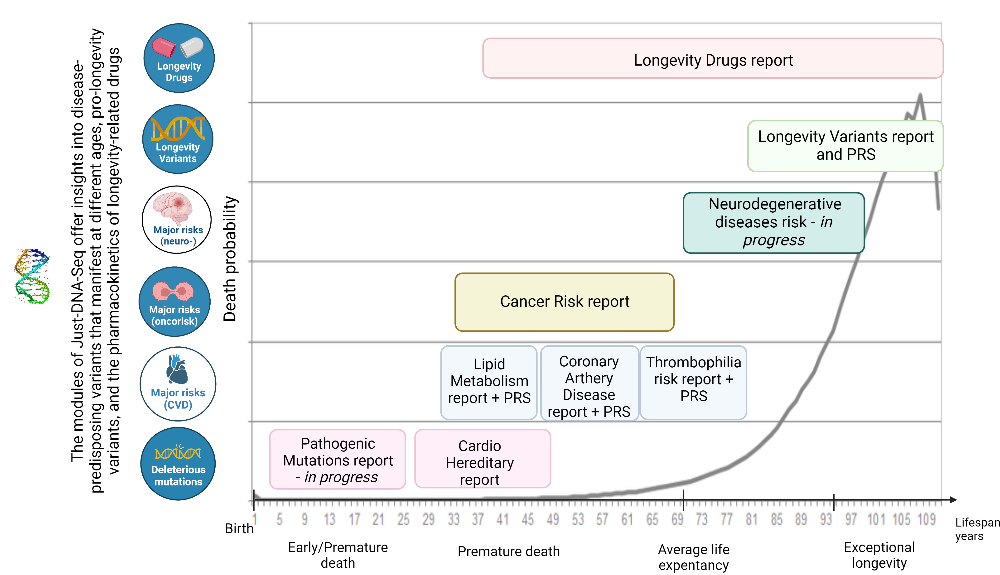

# **Supplementary Data**

**Just-DNA-Lite: a Local-First, Open-Source Platform for Personal Genome Annotation and Polygenic Risk Scoring**

**S1. Generation I: OakVar-based Just-DNA-Seq platform.** Generation I implemented Just-DNA-Seq as annotation and report modules for OakVar (Kulaga et al., 2024). Its pipeline converted the VCF, mapped variants to genes, ran database annotators, aggregated their outputs, applied the project's trait modules as postaggregators and rendered a report. The 2026 reconstruction used nine project postaggregators covering cancer, cardiac disease, coronary artery disease, drug response, longevity, lipid metabolism, thrombophilia, protective alleles and VO2 max; it had no counterpart of Generation II's Pathogenic module. Table S2 lists the installed versions, Table S8 identifies the software repositories, and Figure S1 gives a historical overview of its module domains. The Generation I preprint describes the original platform in detail (https://arxiv.org/abs/2403.19087). Generation I's stages and annotation resources differ from Generation II's direct module-table joins, so the runtime comparison evaluates the configured workflows rather than equal annotation workloads.

{width=95% alt="Diagram of the Generation I module domains along a lifespan axis from birth to exceptional longevity, with a grey curve of death probability that rises with age. Report boxes sit along the axis: pathogenic mutations and hereditary cardiac disease early in life; lipid metabolism, coronary artery disease, thrombophilia and cancer risk in mid-life; neurodegenerative disease risk and longevity variants later; and longevity drugs across adult life. Icons on the left name the domains: longevity drugs, longevity variants, neurological, cancer and cardiovascular risks, and deleterious mutations."}

**Figure S1.** Historical overview of Generation I module domains, including longevity-associated variants, drug response, cardiovascular traits, cancer and deleterious mutations. The lifespan axis illustrates the original organization of the modules; it does not represent predicted survival or measured effects on lifespan. Labels marked “in progress” describe the historical diagram, rather than the current module catalogue.

**S2. Generation I vs Generation II speed comparison.** The individual 2026 Generation I runs (OakVar 2.13.1 on the workstation of Table S6) took 6,005.4, 6,068.5 and 5,889.3 s on Anton Kulaga's published call set on the first night; 10,627.7 and 8,337.6 s on Livia Zaharia's genome on the second day and 8,325.7 s two days later, repeating a third run that a system update had stopped after 1,277.8 s by restarting the Docker daemon; and, with dbSNP alone on the published call set, 7,041.5 s (the warm-up), 3,627.5 and 3,446.8 s. Their peak memory was 3,837 to 4,611 MB. In OakVar's own step times on the published call set (medians of the three runs), the postaggregator step, which runs the Generation I modules, took 38.9% of a run, the annotators 28.7% and the mapper 17.1%. The installed OakVar modules include dbSNP 156.0.1, ClinVar 2026.10.01, gnomAD 2.2.0 (data v2.1), SIFT 1.3.0, GENCODE 46.1.1 and the nine Generation I postaggregators, 0.1.0 to 0.1.2 (Table S2). The speedup reflects the architectural differences described in the main text; this comparison does not isolate their individual contributions. All of these values are generated into `docs/manuscript/benchmarks/a3/tables.md`.

**Run protocol.** After one warm-up run, the Generation II runs of each genome were interleaved in a seeded random order (seed 20261010), with the machine idle. On a second day, with the desktop in light use, Generation II made five more full runs, after a warm-up, on each of the two call sets Generation I ran on, and Generation I ran twice on Livia Zaharia's genome, with a third run on hers two days later on the same kernel and Docker 29.9.0 (earlier runs: 29.8.2); the two systems' runs were not interleaved with each other. The dbSNP-only Generation I series and the Ensembl Generation II series had no separate warm-up run, so the first run of each, which read its database from disk for the first time (OakVar's annotator step took 3,520.3 s, against 608.1 and 574.8 s in the next two runs), is dropped as the warm-up; both first runs are in the repository's record of runs. Generation I ran with no warm-up, using its nine postaggregator modules, with OakVar 2.13.1, the latest release at the time (published 2026-08-30), and the Generation I modules and annotation databases installed from the OakVar store in October 2026, in a Docker image that adds one compatibility line for the store's dbSNP annotator. Some store versions of the Generation I modules differ from those on GitHub; Table S2 lists the versions that ran beside both. All 2026 runs, Generation I included, used the same workstation.

**Table S2.** The OakVar modules that ran in the 2026 Generation I runs, as installed from the OakVar store on 2026-10-11, beside the version of each Just-DNA-Seq repository on GitHub on the same day and at its last commit by 2023-05-07 (date of the last commit in brackets). Modules not maintained by the Just-DNA-Seq project have no GitHub entries. Widget modules, which do not run during annotation, are omitted.

| OakVar module | Type | Version that ran (store) | Data | GitHub head, 2026-10-11 | GitHub, last commit by 2023-05-07 |
|---|---|---|---|---|---|
| vcf-converter | converter | 4.2.1 | — | — | — |
| gencode | mapper | 46.1.1 | — | — | — |
| cardioboost | annotator | 1.0.0 | v2.1 | — | — |
| clinvar | annotator | 2026.10.01 | 2026.10.01 | — | — |
| dbsnp | annotator | 156.0.1 | v156 | — | — |
| gnomad | annotator | 2.2.0 | v2.1 | — | — |
| ncbigene | annotator | 2026.10.01 | 2026.10.01 | — | — |
| omim | annotator | 1.1.1 | v4.1 | — | — |
| pubmed | annotator | 1.1.5 | — | — | — |
| sift | annotator | 1.3.0 | SIFT4G 2016-02-22 | — | — |
| just_cancer | postaggregator | 0.1.0 | — | 0.1.0 (2026-04-11) | 0.1.0 (2023-01-31) |
| just_cardio | postaggregator | 0.1.1 | — | 0.1.1 (2026-04-11) | 0.1.1 (2023-01-31) |
| just_coronary | postaggregator | 0.1.2 | — | 0.1.2 (2024-10-31) | 0.1.1 (2023-01-31) |
| just_drugs | postaggregator | 0.1.0 | — | 0.1.0 (2024-10-31) | 0.1.0 (2023-01-31) |
| just_lipidmetabolism | postaggregator | 0.1.2 | — | 0.1.1 (2024-10-31) | 0.1.0 (2023-03-24) |
| just_longevitymap | postaggregator | 0.1.2 | — | 0.2.0 (2025-03-05) | 0.1.1 (2023-03-11) |
| just_superhuman | postaggregator | 0.1.0 | — | 0.1.0 (2024-11-13) | 0.1.0 (2023-03-26) |
| just_thrombophilia | postaggregator | 0.1.2 | — | 0.2.0 (2026-04-11) | 0.1.0 (2023-03-24) |
| just_vo2max | postaggregator | 0.1.2 | — | 0.1.2 (2024-10-31) | — |
| vcfinfo | postaggregator | 1.4.0 | — | — | — |
| longevity2reporter | reporter | 0.4.3 | — | 0.4.3 (2025-03-05) | 0.4.0 (2023-04-28) |

**S3. Runtime and memory on large PRS scoring files.** Runtimes and memory for the 7 genome-wide PGS IDs (1.7 to 6.9M variants) with both PLINK2 inputs; with the original input PLINK2 failed on the four largest (PGS000013, PGS000014, PGS000016 and PGS000017) because a variant appeared twice in its score file ("ALT1 allele … appears multiple times"), the liftover duplicates that the fixed input merges; logs are in the repository. Memory is measured differently per engine: for DuckDB and Polars, the growth of the benchmark process's resident memory during the call, sampled every 10 ms (median over all 100 scores with the fixed input, 5.4 MB and 1,061.2 MB); for PLINK2, the peak resident memory of its own process, sampled every 100 ms (median 511.6 MB, fixed input). The two measures are not directly comparable. All per-score timings exclude the one-time conversion of the VCF to normalized Parquet or PLINK2 genotype files. The benchmark ran on the workstation of Table S6 and used PLINK2 v2.0.0-a.6.33LM (28 February 2026), with four compute threads; the Python environment used Python 3.13.16, DuckDB 1.5.5 and Polars 1.44.2, whose engines ran with their default thread pools (one thread per logical CPU, 16 on that workstation), so the speed comparison is not at equal thread counts. Each engine was timed once for each score after warm-up, so the runtime distribution is across different models, rather than repeated timings of a single model. The 100 scores are PGS000006 to PGS000106, excluding PGS000085, which the PGS Catalog has retired; PGS000001 to PGS000003 ran first as a warm-up. The benchmark harness fixes the list of scores, calls PLINK2 with the same command line as the just-prs script but keeps its log for every score, and includes PLINK2 in the warm-up (`docs/manuscript/benchmarks/a3/prs/`). PLINK2's two inputs: the *original* input is the one the just-prs benchmark script builds, a genotype file from every record, reference calls included, and variant identifiers (in both allele orders) built from each scoring row's first candidate other allele only; the *fixed* input builds the genotype file from the records just-prs reads (FILTER PASS or unset), gives identifiers for every candidate other allele, and sums the weights of identifiers that two scoring rows share after liftover. Both inputs restrict PLINK2 to the autosomes, while just-prs reads every chromosome. just-prs 0.10.1, the version this harness benchmarked, compared a multi-allelic record's alternate alleles as one string and did not check the other allele; 0.10.2 changed both (Section 3.2). The 0.10.2 rerun reported in Section 4.2 and Tables 3 and 4, with its per-score results and the split of the remaining difference by cause, is in the just-prs repository (`just-prs/benchmarks/results/2026-10-11/`); its PLINK2 input is built as the fixed input above.

The 0.10.1 run, which the 0.10.2 rerun supersedes, also scored chrX, which its PLINK2 runs left out. Against PLINK2 it gave Pearson *r* 0.999997 and a largest score difference of 0.501 with the *fixed* input, and 0.999859 and 21.4 with the *original* input, on which PLINK2 lost every candidate other allele but the first, counted reference-call records and scored 96 of the 100 scores. PLINK2's time excludes preparing its score file, as in the just-prs script; in the 0.10.1 run, including it moved PLINK2's median from 0.602 s to 0.604 s.

**S4. Module sources.** For each annotation module the project publishes in the module registry (https://module-registry.just-dna.life, namespace `just-dna-seq`), as of 2026-10-10 18:00 UTC: version, publication date, artifact digest, curator type, how the module was curated, the source databases with their release, and every paper its rows cite (first author, year, PMID, DOI) with the number of rows citing it. Read from the modules' own published files; later versions may differ. Files: `supplementary/S4_module_sources.md`, `supplementary/S4_module_sources.csv`, `supplementary/S4_module_citations.csv`.

**S5. PGS Catalog coverage of just-prs.** For every score of the PGS Catalog release of 2026-09-17 (6,991 scores), the harmonized GRCh38 scoring file was read in full and each row classified by whether just-prs can place and match it. For just-prs 0.10.1, the audit classified 6,910 files as “as specified”, 76 as “approximated” and 5 as “cannot be scored”. The first category is an audit label: it can include files with less than 10% of absolute weight on rows that cannot be placed or matched. The approximated category includes files at or above that threshold and files meeting other rules, such as dominant or recessive terms scored additively. These are file-level compatibility categories, without evaluating coverage in a particular genome or validating predictions. Method, rules, threshold sensitivity, the distribution of the weight just-prs cannot place or match (Figure S5) and per-file values are in Table S5 (`supplementary/S5_pgs_coverage.md`, `supplementary/S5_pgs_coverage.csv`).

**S6. Benchmark hardware and inputs.** The workstation, software versions and input genomes of the annotation benchmark in Section 4.1, recorded at run time (Table S6).

**Table S6.** Benchmark hardware and inputs, recorded at run time (October 2026).

| Parameter | Value |
|---|---|
| CPU | AMD Ryzen 7 3800X (8 cores, 16 threads) |
| RAM | 63 GiB |
| Storage | SATA SSD, NTFS through the Linux ntfs3 driver (data, caches and outputs) |
| OS | Linux 7.2 |
| Generation II | Just-DNA-Lite 0.3.25 (commit bb4b294), Python 3.13.16, Polars 1.44.2, polars-bio 0.36.0, DuckDB 1.5.5 and Dagster 1.13.24; 10 modules (versions and digests as in Table S4) |
| Generation I | OakVar 2.13.1 in Docker (Table S2) |
| Input: Anton Kulaga, published call set | 6,079,744 records (4,616,002 SNVs), DeepVariant 1.1.0, GRCh38 |
| Input: Livia Zaharia | 5,064,598 records (4,104,611 SNVs), DRAGEN 13.021.779.4.4.4, GRCh38 |
| Input: Community reference | 7,753,721 records (6,476,847 SNVs), DeepVariant 1.0.0, GRCh38 |

**S7. Comparison with other tools.** The features that Just-DNA-Lite and 23 tools for personal-genome annotation, polygenic scoring and AI-assisted interpretation document for themselves, read on 10 October 2026 from each project's own documentation, README or paper; the evidence for every cell, with links, is in the repository (`docs/manuscript/v0.4/c36-tool-comparison-draft.md`). The same file lists the tools considered and not tabulated, with the reason for each.

**Table S7.** Documented features of Just-DNA-Lite and tools for personal-genome annotation, polygenic scoring and AI-assisted interpretation, as of 10 October 2026. Feature comparison only; no cell is a claim about accuracy, speed or usability.

| Tool | Runs locally (no upload) | Graphical interface | Add annotation sets without code | PRS (PGS Catalog) | Ancestry-aware percentiles | Human-readable report | AI-assistant (MCP) access | Open source (licence) | Last release (date) | Reference |
|---|---|---|---|---|---|---|---|---|---|---|
| **Just-DNA-Lite** | Yes | Yes (local web UI) | Yes | Yes | Yes | Yes | Yes | Yes (AGPL-3.0) | v0.3.18 (2026-08-16) | this work |
| *Variant annotation engines* | | | | | | | | | | |
| Ensembl VEP | Yes (also hosted) | Hosted web form only^a^ | Yes | No | n/a | Partial^b^ | No^c^ | Yes (Apache-2.0) | 116.3 (2026-10-09) | McLaren et al., 2016 |
| ANNOVAR | Yes (also hosted: wANNOVAR) | Hosted web form only^a^ | Yes | No | n/a | No | No | No (free for non-commercial use)^kk^ | ? (2025-03-02)^d^ | Wang et al., 2010 |
| SnpEff / SnpSift | Yes | No | Yes | No | n/a | Partial^b^ | No | Yes (MIT) | 5.4c (2026-02-23) | Cingolani et al., 2012a, 2012b |
| vcfanno | Yes | No | Yes | No | n/a | No | No | Yes (MIT) | 0.3.9 (2026-06-16) | Pedersen et al., 2016 |
| echtvar | Yes | No | Yes | No | n/a | No | No | Yes (MIT) | 0.2.4 (2026-04-30) | Pedersen & de Ridder, 2023 |
| *Personal-genome platforms and reports* | | | | | | | | | | |
| OpenCRAVAT | Yes (also hosted) | Yes (local web UI; also hosted) | Partial^cc^ | No | n/a | Partial^dd^ | Partial^ee^ | Yes (MIT) | 3.2.1 (2026-10-08) | Pagel et al., 2020 |
| OakVar^e^ | Yes | Yes (local web UI) | Partial^cc^ | ?^ff^ | ?^ff^ | Partial^dd^ | No | No (proprietary; free for non-commercial use after registration) | 2.13.1 (2026-08-30) | Oak Bioinformatics, 2026 (software) |
| GenomeChronicler | Yes | No | ? | No | n/a | Yes (PDF) | No | ?^gg^ | 0.91 (2019-10-26); fixes merged 2026-07-09 | Guerra-Assunção et al., 2020 |
| SNPedia / Promethease | No (upload to paid service) | Hosted web form | No | ? | ? | Yes (interactive HTML) | ? | No (closed service; SNPedia content CC BY-NC-SA 3.0) | n/a (service operating 2026-10-10)^hh^ | Cariaso & Lennon, 2012 |
| impute.me (discontinued 2022) | Partial (hosted; local Docker route documented) | Hosted web form | ? | Partial^ii^ | Yes (Z-scores per 1000 Genomes superpopulation) | Partial | n/a | Yes (LGPL-3.0; code no longer on GitHub) | 1.0.7 (2021-11-02)^jj^ | Folkersen et al., 2020 |
| VCFshiny | Yes | Yes (local web UI) | Partial^f^ | No | n/a | Partial^g^ | No | Yes (MIT) | none tagged; last code commit 2024-10-16 | Chen et al., 2023 |
| PharmCAT | Yes | No | Partial^h^ | No | n/a | Yes | No | Yes (MPL-2.0) | 3.4.0 (2026-07-14) | Sangkuhl et al., 2020; Li et al., 2023 |
| ACVI-Med | Yes (self-hosted) | Yes (local web UI) | Partial^i^ | ? | n/a | Partial^g^ | No | Yes (MIT) | none tagged; last commit 2026-05-28 | Stadler et al., 2026 |
| Personal-Genome-Pipeline | Yes | No | Partial^j^ | Yes | Yes | Yes | No | Yes (GPL-3.0-or-later) | 0.8.2 (2026-07-01) | GeiserX, 2026 (software) |
| *Polygenic score tools* | | | | | | | | | | |
| PLINK 2 | Yes | No | n/a^k^ | Partial^l^ | ? | ? | No | Yes (GPL-3.0) | 2.0.0-a.7.11 (2026-10-01) | Chang et al., 2015 |
| PRSice-2 | Yes | No | n/a^k^ | No^m^ | ? | Partial^n^ | No | Yes (GPL-3.0) | 2.3.5 (2021-09-20)^o^ | Choi & O'Reilly, 2019 |
| pgsc_calc | Yes | No | n/a^k^ | Yes^p^ | Yes (optional) | Partial^q^ | No | Yes (Apache-2.0) | 2.3.0 (2026-06-03) | Lambert et al., 2024 |
| GenoPred | Yes | No | n/a^k^ | Yes | Partial^r^ | Yes | No | Yes (GPL-3.0) | 2.3.3 (2025-11-27) | Pain et al., 2024 |
| Imputation Server PGS / pgs-calc | Yes (pgs-calc; server requires upload) | Hosted web form only^a^ | n/a^k^ | Yes | No^s^ | Partial^q^ | No | Yes (MIT) | pgs-calc 1.6.2 (2025-10-28) | Forer et al., 2024 |
| PRSKB | Yes (CLI; web version computes in the browser) | Yes (web page, in-browser) | n/a^k^ | Partial^t^ | Partial^u^ | Partial^v^ | No | No (free for academic use) | 1.0.0 (2022-06-23); last commit 2024-08-22 | Page et al., 2022 |
| PGS Browser / pgsb-cli | Yes (scoring); interpretation hosted | Partial^w^ | n/a^k^ | Yes | Partial^x^ | Partial^v^ | No | No (CC BY-NC-ND 4.0) | none tagged; last commit 2026-05-14 | Kolosov et al., 2026 |
| *AI-assistant and LLM interpretation* | | | | | | | | | | |
| GeneChat MCP | Yes^y^ | No | No | Yes (4 bundled scores) | No | Partial^z^ | Yes | Yes (MIT) | none tagged; last commit 2026-04-13 | Costello, 2026 (software) |
| DeepRare | Partial^aa^ | Hosted web app (by request) | ? | No | n/a | Yes (hosted app) | No^bb^ | No (CC BY-NC 4.0) | none tagged; last commit 2026-04-14 | Zhao et al., 2026 |

**Column definitions.** *Runs locally*: the core analysis runs on the user's machine without uploading the genome to a third-party server; "also hosted" marks tools that additionally offer an upload service. *Graphical interface*: a GUI for the core analysis, either local or hosted (stated). *Add annotation sets without code*: a user adds a new annotation source by supplying data files and configuration, without writing program code (n/a for tools that do not annotate variants). *PRS (PGS Catalog)*: computes scores from PGS Catalog scoring files; Partial when only generic user-formatted weights are accepted. *Ancestry-aware percentiles*: places the score against a reference population matched to, or chosen for, the sample's ancestry. *Human-readable report*: output meant to be read by a person (narrative or interpreted summary), beyond an annotated VCF or table; Partial for run statistics, QC dashboards or interactive tables without interpretation. *AI-assistant access*: an MCP server (or documented LLM tool interface) from the project itself. *Last release*: latest tagged release on GitHub or the official download page; where none exists, the last commit.

**Table notes.**

^a^ The local version is command-line only; the graphical interface requires uploading data to the hosted service.

^b^ HTML run summary with variant-consequence statistics and charts; no interpretation of individual findings.

^c^ No Ensembl MCP server; third-party wrappers exist (e.g. VEPmcp), which call the Ensembl REST API rather than a local VEP.

^d^ The 2025-03-02 software update is announced without a version label.

^e^ OakVar is a fork of OpenCRAVAT; Generation I of Just-DNA-Seq was built on it, and its author, Ryangguk Kim, co-authored the Generation I preprint (Kulaga et al., 2024) and is thanked in the Acknowledgments.

^f^ Users select from ANNOVAR's database list in the interface; adding a user's own source is not documented.

^g^ Interactive tables and plots (VCFshiny) or ACMG-guided tiering for clinicians (ACVI-Med); no exported narrative report described.

^h^ Custom named-allele definitions (JSON) for pharmacogene diplotype calling only.

^i^ Additional sources are added at the VEP annotation step (`--custom`); the importer then indexes any INFO/CSQ field without code.

^j^ A PGS Catalog score is added by one line in a configuration table; the annotation databases are a fixed set.

^k^ Not a variant-annotation tool.

^l^ Generic score files (variant, allele, weight); the documentation does not mention the PGS Catalog format, which needs column mapping.

^m^ Computes PRS from GWAS summary statistics by clumping and thresholding; precomputed weights can be supplied (`--no-clump`) but the PGS Catalog is not mentioned.

^n^ Plots of model fit across a cohort, not a per-person result.

^o^ No release since 2021; occasional fixes to 2026-04-10, and the site states the software is being rebuilt.

^p^ The README states that whole-genome sequencing VCFs are not currently supported directly (gVCF conversion suggested).

^q^ HTML report of score distributions and variant-matching QC across samples, not a per-person narrative.

^r^ Scores are standardized against an ancestry-matched reference (PC projection); percentiles are not described.

^s^ Ancestry is estimated, but used only to warn about or exclude mismatched samples.

^t^ Uses NHGRI-EBI GWAS Catalog associations, not PGS Catalog scoring files; user summary statistics accepted.

^u^ Percentile against a user-chosen cohort (UK Biobank by default; 1000 Genomes superpopulations available), not matched automatically.

^v^ Tabular output with standardized scores or percentiles; interactive web views (PGS Browser) or website plots limited to precomputed data (PRSKB).

^w^ A hosted Shiny application that takes the locally computed percentile, sex and age; the genome never reaches it, and scoring itself runs on the command line.

^x^ Scores adjusted for the first five genetic principal components; the reference distribution is FinnGen.

^y^ The VCF stays local, but tool responses (genotypes, interpretations) go to the user's LLM provider unless a local model is used; the same boundary applies to Just-DNA-Lite's MCP server.

^z^ A structured genome summary tool; narrative text comes from the client's language model.

^aa^ Exomiser runs on the VCF locally; the reasoning tier calls a commercial LLM API unless the code is adapted, and the authors recommend their hosted application.

^bb^ The paper describes the agent architecture as "inspired by" MCP; no MCP server is offered to outside clients.

^cc^ Prebuilt annotation modules install from a store through the interface; authoring a new annotator requires editing a Python file.

^dd^ Interactive result viewer and tabular, Excel or VCF reporters; no narrative report described in the core documentation.

^ee^ An official MCP server (Oct 2025) hosted at mcp.opencravat.org (KarchinLab, 2025), which annotates single variants through public OpenCRAVAT services; it has no access to a user's local genome or jobs.

^ff^ Not mentioned in OakVar's own documentation. An OakVar module from the authors' Generation I Just-DNA-Seq (Kulaga et al., 2024) computed PGS Catalog scores as percentiles against simulated gnomAD-frequency genotypes, without ancestry matching.

^gg^ No licence file in the repository; the paper describes the pipeline as "fully open source".

^hh^ Promethease has been owned by MyHeritage since 2019; reports cost US$25. The cited 2012 paper describes Promethease as a free program downloaded to the user's computer; the current service takes uploaded files. SNPedia editing has been sparse since 2023.

^ii^ Scores for 1,859 GWAS traits and 634 UK Biobank traits, mostly from genome-wide significant SNPs, with LDpred weights for 20 major diseases; the paper cites the PGS Catalog once, in passing, and does not describe scoring from its files.

^jj^ The site has redirected to a commercial service (Nucleus Genomics) since June 2022; the repository now holds only a README.

^kk^ The 2010 paper calls ANNOVAR open-source and freely available to the academic community; the current download terms make it free for personal, academic and non-profit use only, with commercial licences from QIAGEN.

**Cell convention.** "No" means the project's documentation or paper, read in full, describes the tool's scope without the feature; "?" means the material available did not settle it.

### References for Table S7

Cariaso, M., & Lennon, G. (2012). SNPedia: a wiki supporting personal genome annotation, interpretation and analysis. *Nucleic Acids Research*, 40(D1), D1308–D1312. doi:10.1093/nar/gkr798.

Chang, C. C., Chow, C. C., Tellier, L. C. A. M., Vattikuti, S., Purcell, S. M., & Lee, J. J. (2015). Second-generation PLINK: rising to the challenge of larger and richer datasets. *GigaScience*, 4, 7. doi:10.1186/s13742-015-0047-8.

Chen, T., et al. (2023). VCFshiny: an R/Shiny application for interactively analyzing and visualizing genetic variants. *Bioinformatics Advances*, 3(1), vbad107. doi:10.1093/bioadv/vbad107.

Choi, S. W., & O'Reilly, P. F. (2019). PRSice-2: Polygenic Risk Score software for biobank-scale data. *GigaScience*, 8(7), giz082. doi:10.1093/gigascience/giz082.

Cingolani, P., Platts, A., Wang, L. L., Coon, M., Nguyen, T., Wang, L., Land, S. J., Lu, X., & Ruden, D. M. (2012a). A program for annotating and predicting the effects of single nucleotide polymorphisms, SnpEff: SNPs in the genome of *Drosophila melanogaster* strain w1118; iso-2; iso-3. *Fly*, 6(2), 80–92. doi:10.4161/fly.19695.

Cingolani, P., Patel, V. M., Coon, M., Nguyen, T., Land, S. J., Ruden, D. M., & Lu, X. (2012b). Using *Drosophila melanogaster* as a model for genotoxic chemical mutational studies with a new program, SnpSift. *Frontiers in Genetics*, 3, 35. doi:10.3389/fgene.2012.00035.

Folkersen, L., Pain, O., Ingason, A., Werge, T., Lewis, C. M., & Austin, J. (2020). Impute.me: an open-source, non-profit tool for using data from direct-to-consumer genetic testing to calculate and interpret polygenic risk scores. *Frontiers in Genetics*, 11, 578. doi:10.3389/fgene.2020.00578.

Forer, L., Taliun, D., LeFaive, J., Smith, A. V., Boughton, A. P., Coassin, S., Lamina, C., Kronenberg, F., Fuchsberger, C., & Schönherr, S. (2024). Imputation Server PGS: an automated approach to calculate polygenic risk scores on imputation servers. *Nucleic Acids Research*, 52(W1), W70–W77. doi:10.1093/nar/gkae331.

Guerra-Assunção, J. A., Conde, L., Moghul, I., Webster, A. P., Ecker, S., Chervova, O., Chatzipantsiou, C., Prieto, P. P., Beck, S., & Herrero, J. (2020). GenomeChronicler: the Personal Genome Project UK genomic report generator pipeline. *Frontiers in Genetics*, 11, 518644. doi:10.3389/fgene.2020.518644.

Kolosov, N., Reeve, M. P., Della Briotta Parolo, P., Kurki, M. I., FinnGen, Llorens, V., Sipilä, T. P., Herman, A., Molotkov, I., Aavikko, M., Ripatti, S., Palotie, A., Daly, M. J., & Artomov, M. (2026). PGS Browser: a public platform for personalized polygenic score analysis and interpretation. *Nature Communications*, 17, 7806. doi:10.1038/s41467-026-74461-7.

Kulaga, A., et al. (2024). Just-DNA-Seq, open-source personal genomics platform: longevity science for everyone. *arXiv*:2403.19087. https://arxiv.org/abs/2403.19087.

Lambert, S. A., Wingfield, B., Gibson, J. T., et al. (2024). Enhancing the Polygenic Score Catalog with tools for score calculation and ancestry normalization. *Nature Genetics*, 56(10), 1989–1994. doi:10.1038/s41588-024-01937-x.

Li, B., Sangkuhl, K., Keat, K., Whaley, R. M., Woon, M., Verma, S., Dudek, S., Tuteja, S., Verma, A., Whirl-Carrillo, M., Ritchie, M. D., & Klein, T. E. (2023). How to run the Pharmacogenomics Clinical Annotation Tool (PharmCAT). *Clinical Pharmacology & Therapeutics*, 113(5), 1036–1047. doi:10.1002/cpt.2790.

McLaren, W., Gil, L., Hunt, S. E., Riat, H. S., Ritchie, G. R. S., Thormann, A., Flicek, P., & Cunningham, F. (2016). The Ensembl Variant Effect Predictor. *Genome Biology*, 17, 122. doi:10.1186/s13059-016-0974-4.

Page, M. L., Vance, E. L., Cloward, M. E., et al. (2022). The Polygenic Risk Score Knowledge Base offers a centralized online repository for calculating and contextualizing polygenic risk scores. *Communications Biology*, 5, 899. doi:10.1038/s42003-022-03795-x.

Pagel, K. A., Kim, R., Moad, K., Busby, B., Zheng, L., Tokheim, C., Ryan, M., & Karchin, R. (2020). Integrated informatics analysis of cancer-related variants. *JCO Clinical Cancer Informatics*, 4, 310–317. doi:10.1200/CCI.19.00132.

Pain, O., Al-Chalabi, A., & Lewis, C. M. (2024). The GenoPred pipeline: a comprehensive and scalable pipeline for polygenic scoring. *Bioinformatics*, 40(10), btae551. doi:10.1093/bioinformatics/btae551.

Pedersen, B. S., Layer, R. M., & Quinlan, A. R. (2016). Vcfanno: fast, flexible annotation of genetic variants. *Genome Biology*, 17, 118. doi:10.1186/s13059-016-0973-5.

Pedersen, B. S., & de Ridder, J. (2023). Echtvar: compressed variant representation for rapid annotation and filtering of SNPs and indels. *Nucleic Acids Research*, 51(1), e3. doi:10.1093/nar/gkac931.

Sangkuhl, K., Whirl-Carrillo, M., Whaley, R. M., et al. (2020). Pharmacogenomics Clinical Annotation Tool (PharmCAT). *Clinical Pharmacology & Therapeutics*, 107(1), 203–210. doi:10.1002/cpt.1568.

Stadler, M., Gansberger, S., Borik-Heil, L., Griss, J., Okamoto, I., Weninger, W. P., & Wielscher, M. (2026). ACVI-Med, an open source variant interpretation tool for medical genomics. *BMC Bioinformatics*, 27, 85. doi:10.1186/s12859-026-06414-2.

Wang, K., Li, M., & Hakonarson, H. (2010). ANNOVAR: functional annotation of genetic variants from high-throughput sequencing data. *Nucleic Acids Research*, 38(16), e164. doi:10.1093/nar/gkq603.

Zhao, W., Wu, C., Fan, Y., et al. (2026). An agentic system for rare disease diagnosis with traceable reasoning. *Nature*, 651(8106), 775–784. doi:10.1038/s41586-025-10097-9.

Software without a paper (cite as software, accessed 10 October 2026):

Costello, N. (2026). GeneChat MCP server [software]. https://github.com/natecostello/genechat-mcp.

GeiserX (2026). Personal-Genome-Pipeline, version 0.8.2 [software]. https://github.com/GeiserX/Personal-Genome-Pipeline.

KarchinLab (2025). OpenCRAVAT MCP server [software]. https://github.com/KarchinLab/oc-mcp.

Oak Bioinformatics (2026). OakVar, version 2.13.1 [software]. https://github.com/rkimoakbioinformatics/oakvar.

**S8. Software repositories.**

**Table S8.** Software repositories of both generations.

| Repository | Description | Generation |
|---|---|---|
| [just-dna-lite](https://github.com/dna-seq/just-dna-lite) | Main platform: standalone genomic annotation | Gen II |
| [just-prs](https://github.com/dna-seq/just-prs) | PRS computation library/CLI/UI | Gen II |
| [just-dna-compiler](https://github.com/dna-seq/just-dna-compiler) | Annotation module schema (just-dna-format), manifest/integrity contract, and reference compiler | Gen II |
| [just-dna-registry](https://github.com/dna-seq/just-dna-registry) | Catalogue and versioned distribution of annotation modules | Gen II |
| [just-prs-mcp](https://github.com/dna-seq/just-prs-mcp) | MCP server exposing just-prs to Claude, Cursor, Codex, Antigravity, and other AI agents, with trait-panel graphics and interpretation prompts | Gen II |
| [prepare-annotations](https://github.com/dna-seq/prepare-annotations) | Pipelines converting annotation databases to Parquet | Gen II |
| [reflex-mui-datagrid](https://github.com/dna-seq/reflex-mui-datagrid) | Reflex wrapper for MUI DataGrid | Gen II |
| [just-biomarkers](https://github.com/dna-seq/just-biomarkers) | Methylation and other biomarker analysis tools | Gen II |
| [just-module-creator](https://github.com/dna-seq/just-module-creator) | Authoring plugin (MCP tools and skills) for drafting, checking, compiling, and publishing annotation modules inside AI coding assistants | Gen II |
| [dna-seq](https://github.com/dna-seq/dna-seq) | Original DNA-Seq pipeline | Gen I |

**S9. Sex chromosomes and the mitochondrial genome in just-prs.** How just-prs scores X, Y, the pseudoautosomal regions and the mitochondrial genome (Section 3.2), and a benchmark that includes them (Section 4.2).

On the sex chromosomes and the mitochondrial genome, both engines count copies of the effect allele. just-prs infers the sample's karyotype from the share of heterozygous calls on the non-pseudoautosomal part of X, relative to the autosomes, and from the number of calls on the non-pseudoautosomal part of Y, relative to those on X. For a man it counts a homozygous call there as one copy and treats a heterozygous call as a no-call, since a single X cannot be heterozygous. The pseudoautosomal regions count as two copies in either sex and the mitochondrial genome as one; when the karyotype cannot be inferred, X and Y are scored as written.

The comparison in Section 4.2 covers chromosomes 1 to 22. The just-prs project's own benchmark (just-prs 0.10.4) scored 195 PGS Catalog scores on the same genome with X, Y, the pseudoautosomal regions and the mitochondrial genome included: the 100 above and further scores with rows on those chromosomes. The sample was marked male in PLINK2, and just-prs inferred it as male (XY). Against PLINK2 with its X model 1 (half a copy for a heterozygous call on a man's X), Pearson *r* was 0.99999847 and 114 of the 195 scores agreed to within 10⁻³. The largest difference, 2.95 on a PLINK2 score of 854.9 (PGS001108), comes from heterozygous calls on the non-pseudoautosomal part of X, which just-prs treats as no-calls; removing that share leaves a largest remaining difference of 0.14 across the 195 scores. DuckDB and Polars agreed to within 2.27 × 10⁻¹³. This run is not used for timing. Its per-score results, settings and software commit are available at https://github.com/dna-seq/just-prs/tree/main/just-prs/benchmarks/results/2026-10-13-sexchr.

**S10. Stage times and resources of the annotation runs.** Stage times, peak memory and CPU use of the full runs of Section 4.1.

**Table S10.** Stage times and resources of the full annotation runs of Section 4.1 (medians unless stated). The stage times are those of the Dagster job; the wall time in Table 2 also includes about 5 s of Python start-up and module discovery. Peak RAM is the resident memory summed over the whole process tree (for Generation I, the container's processes), sampled ten times a second; pages shared between processes count once per process, which overstates the total, while a peak shorter than the sampling interval can be missed. CPU is user plus system time divided by wall time; it was not recorded for Generation I, which ran inside Docker. Generation I has no counterpart of the three Generation II stages, so its stage cells are dashes; S2 gives OakVar's own steps. Warm and cold runs are in the repository's generated tables.

| Genome | Run | *n* (runs) | Normalize (s) | Annotate (s) | Report (s) | Peak RAM, median (MB) | Peak RAM, max (MB) | CPU (%) |
|---|---|---|---|---|---|---|---|---|
| Anton Kulaga, published call set | Generation II, full | 10 | 15.7 | 10.2 | 1.9 | 2,235 | 2,270 | 375 |
| Anton Kulaga, published call set | Generation I | 3 | — | — | — | 4,610 | 4,611 | — |
| Livia Zaharia | Generation II, full | 10 | 43.4 | 14.6 | 1.8 | 4,436 | 4,514 | 335 |
| Livia Zaharia | Generation I | 3 | — | — | — | 4,529 | 4,529 | — |
| Community reference | Generation II, full | 5 | 20.9 | 10.6 | 1.8 | 2,893 | 2,925 | 363 |

**S11. Use of AI tools.** Claude Code (Anthropic; mostly the Claude Opus 5.5 model) was the main AI assistant. Codex (OpenAI; mostly GPT-6.1 Sol) was used from time to time as a second model to check Claude Code's output. The authors wrote harnesses that run these checks to catch potential mistakes. Claude Code drafted and rewrote passages throughout the manuscript, the Results and Discussion included, and checked the text against the code, the benchmark tables and the cited sources. In the research itself, AI agents running the curation skills of the just-prs plugin for Claude Code annotated what a higher score means for the curated scores of Section 3.2, which await expert review. The authors reviewed the output, and every number in the benchmark tables is generated by a script from the recorded runs in the repository (`docs/manuscript/benchmarks/a3/`).

**S12. Reference-genotype restoration in annotation.** The current annotation engine distinguishes called genotypes from inferred homozygous-reference genotypes. For variant-only call sets classified as whole-genome, it can restore a module's authored reference-genotype rows at sites the caller did not emit. Classification requires at least one million sites and at least 75% of the span between the first and last calls on each chromosome, summed across chromosomes, to lie within the configured flank of a call; a restored site must be within 10 kb of a called variant by default. Ambiguously placed module variants are excluded. Where the Genome in a Bottle low-mappability and segmental-duplication mask is available, sites inside it are excluded; otherwise, rows explicitly requiring callability evidence are withheld. Reports label restored rows as inferred and show their number on its own; the report's totals, positive and negative counts and summed weight include them. Nearby calls do not establish per-base callability. This annotation procedure is distinct from the optional PRS restoration described in Section 3.2.

**S13. A worked Longevity Variants report row.** This example was extracted from an existing report for Anton Kulaga's public genome. The local input's SHA-256 matches the public call set recorded in `docs/manuscript/benchmarks/a3/inputs.json` (Zenodo 18370498). The normalized genotype, annotated Parquet row and rendered HTML agree on FOXO3 rs2802292, G/T, with weight 0.475. The annotated row records the genotype as `called`. The report places it in the insulin-signalling category, displays the direction as Protective and links five study records: Southern Italian (PMID 19415983), Han Chinese (PMIDs 19793722 and 20884733), Japanese-American (PMID 18765803) and Danish (PMID 20849522). These are the module's stored descriptions of the studies, not independently re-estimated effects. The weight is a curation weight and does not quantify a change in lifespan.

The stored report states no module version. It displays the build-digest prefix `7ac6a922f7f4` and the source `just-dna-seq/annotators`; the digest is the module's claim and was not independently verified. A registered copy, `just-dna-seq/longevitymap@1.2.0`, reproduces the extracted row and its five study records, but does not supply the missing version of the report's own build. The machine-readable extract, including the report checksum, called genotype, conclusion and linked study records, is provided as `supplementary/S13_worked_report_row.json`. The source HTML and Parquet paths in that extract identify local working files; the source genome is public, and the extract carries the fields used in the main-text example. Figure 1b shows the same row in another report of the same genome, made by the public demonstration on 27 September 2026 (`report_20260927_120929.html`) and captured for the figure on 26 October 2026, which records no module version or build; its Longevity Variants section counts 299 matched variants against 292 in the extracted report, while the FOXO3 row, its weight and its five study records are the same.

**Provenance of the supplied report examples.** The author supplied an [annotation report for Anton Kulaga](https://drive.google.com/file/d/1GN3_GwlYOBQtXHfHzC75RAYv7eJkeScQ/view) and a [separate PRS summary](https://drive.google.com/file/d/1WhxN5YvCjP3dRDFfo7p-vcYs_gPB1cvq/view). The annotation report reproduces the worked row and all five study records above. According to the author's account, the PRS summary followed a separate computation of approximately 4,000 polygenic scores with Just-DNA-Seq and selection and summary of the most interesting findings. “Semi manual” describes that selection and summary, not manual score calculation. This example is separate from the 100-score engine benchmark. The summary alone does not identify every scoring model or the exact software version and settings; those would be needed to reproduce its quantitative summaries. Figure 2 uses recorded annotation fields; the PRS summary is retained as an example of exploration following computation.
