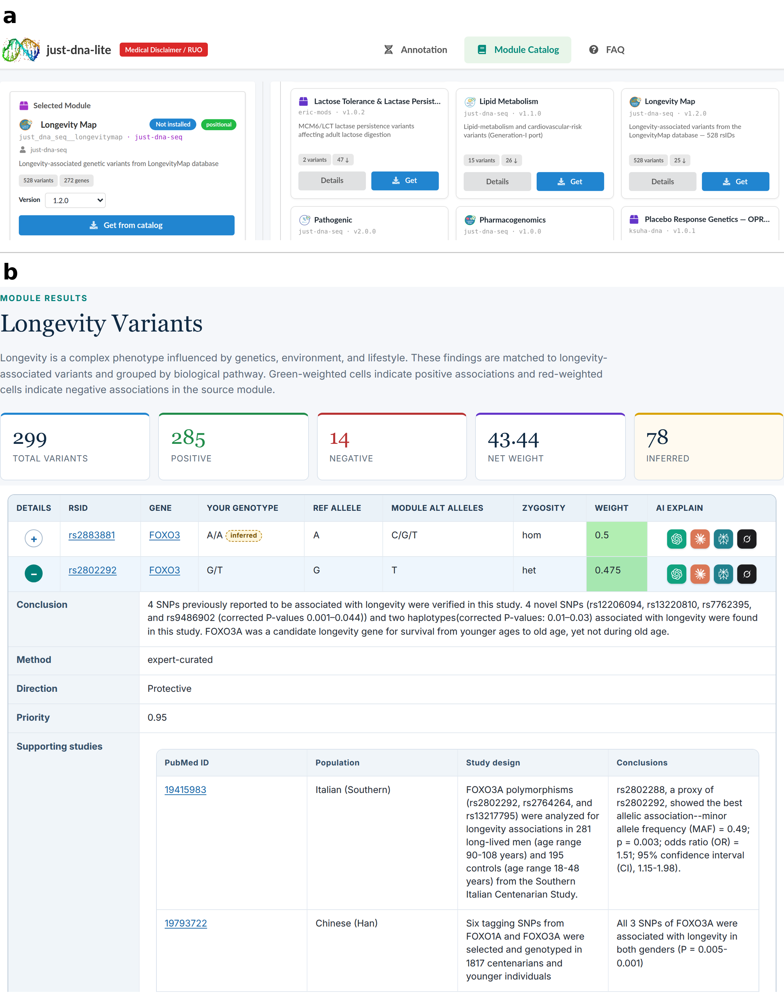
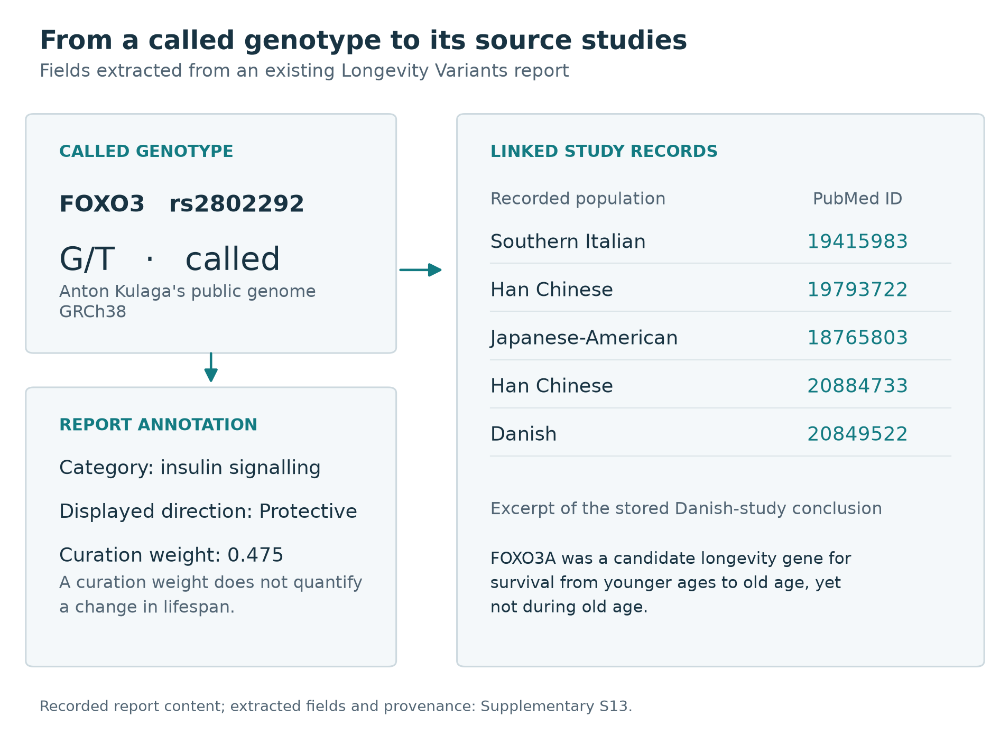
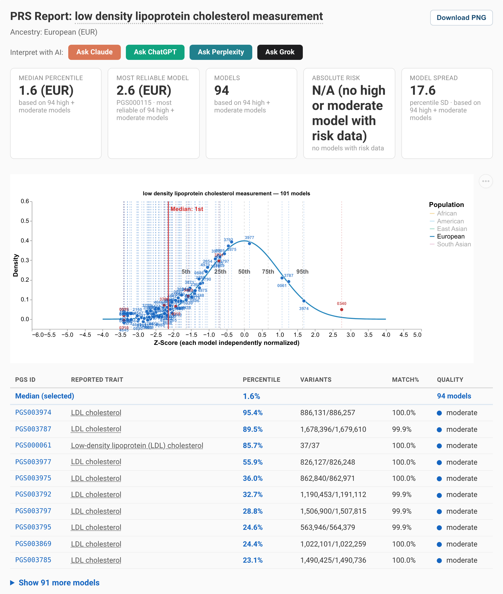

# **Just-DNA-Lite: a Local-First, Open-Source Platform for Personal Genome Annotation and Polygenic Risk Scoring**

> **Draft v0.7 (Paper 1 of 2).** This is the platform paper: the local-first platform and the compute engines it runs — the annotation pipeline, the just-prs computation library **and its `just-prs-mcp` access layer**, the no-code module format, the web UI, `just-dna-format`, and the module registry. The boundary with the companion paper is *consuming* versus *authoring*: this paper covers how a compiled module or a published score is discovered, computed against a genome, and reported, including from an AI assistant that calls these operations as typed tools. The companion paper covers the other direction — an assistant *producing* new annotation content: the authoring plugin, the enrichment and compilation toolchain, and how modules are published and versioned. It is *Creating and Sharing Genomic Annotation Modules with AI: The Just-DNA Ecosystem* (<!-- @rev N6 rounds=2 by=claude:2026-10-15,claude:2026-10-19 -->entered at EASRP 2026 and not selected for the final, so its journal is still to be chosen; draft mirror: `paper2-just-module-creator.md`). See `docs/manuscript/v0.3/manuscript-strategy-v0.3.md` and, for venues, `docs/manuscript/manuscript_journal_strategy.md` (section "Venues, October 2026").<!-- @/rev N6 -->

<!-- @rev AU1 rounds=1 by=claude:2026-10-26 -->
**Authors:** Kulaga Anton^1,2,†^, Usanov Nikolay^3,4,†^, Borysova Olga^4^, Karmazin Alexey^3,4^, Koval Maria^4^, Pushkareva Malvina^4^, Zaharia Livia^1^, Fuellen Georg^1,\*^, Tacutu Robi^2,\*^
<!-- @/rev AU1 -->

**Affiliations:**

<!-- @rev AU2 rounds=1 by=claude:2026-10-26 -->
1. Institute for Biostatistics and Informatics in Medicine and Ageing Research, Rostock University Medical Center, Rostock, Germany
<!-- @rev R1 rounds=1 by=robi:2026-09-25 -->
2. Institute of Biochemistry of the Romanian Academy, Bucharest, Romania
<!-- @/rev R1 -->
3. HEALES (Healthy Life Extension Society)
4. SecvADN SRL
<!-- @/rev AU2 -->

<!-- @rev V7 rounds=1 by=claude:2026-10-19 -->
† These authors contributed equally. \* Co-supervising authors.
<!-- @/rev V7 -->

---

## **Abstract**

<!-- @rev C2a rounds=14 by=robi:2026-09-25,claude:2026-10-10,claude:2026-10-13,codex:2026-10-19,codex:2026-10-26,claude:2026-10-26,claude:2026-10-26,claude:2026-10-26,claude:2026-10-26,claude:2026-10-26,claude:2026-10-27,claude:2026-10-27,claude:2026-10-28,claude:2026-10-28 -->
Just-DNA-Lite is the core of an open-source ecosystem for reading a personal genome against published evidence on the user's own computer. Its web platform annotates a whole-genome VCF and computes polygenic risk scores locally, so the genome does not have to be uploaded.

What the platform reports comes from modules, versioned tables of variant-trait associations that researchers write without programming. Ready-made modules cover longevity, disease predisposition and drug response. Researchers publish new ones to just-dna-registry, an open registry that works like an app store, where others browse, install and apply them with no software update. The just-module-creator plugin drafts modules from the literature and public databases inside the AI assistant a researcher already uses.

Every matched variant links to its reported effect and its sources. Polygenic scores come from just-prs, a library that also works on its own. It computes PGS Catalog scores from a cleaned copy of the Catalog, places each within a reference population matched to the genome's inferred ancestry, labels its quality and shows all models for a trait side by side, so users see where the models agree and differ.

AI assistants can also run annotation and scoring through Model Context Protocol servers, and a public demonstration lets anyone try the platform on public genomes.
<!-- @/rev C2a -->

## **1. Introduction**

<!-- @rev JA1a rounds=1 by=claude:2026-10-27 -->
### **1.1 Background and Significance**
<!-- @/rev JA1a -->

<!-- @rev P1 rounds=3 by=claude:2026-10-19,codex:2026-10-19,claude:2026-10-28 -->
Researchers who receive raw variant files (VCFs) containing millions of variants
<!-- @/rev P1 -->
<!-- @rev C4 rounds=5 by=robi:2026-09-25,claude:2026-10-10,claude:2026-10-19,claude:2026-10-27,claude:2026-10-27 -->
can find it hard to annotate them against published databases without bioinformatics and programming expertise (Chen et al., 2023), and acquiring that expertise takes time away from the questions they set out to answer. Many consumers who download their raw data from a testing company take it to third-party interpretation tools (Nelson et al., 2019; O'Daniel et al., 2025).
<!-- @/rev C4 -->

<!-- @rev C3 rounds=7 by=robi:2026-09-25,claude:2026-10-10,codex:2026-10-19,claude:2026-10-26,claude:2026-10-26,claude:2026-10-27,claude:2026-10-27 -->
Several companies now offer direct-to-consumer sequencing services (O'Daniel et al., 2025). The National Human Genome Research Institute (NHGRI) estimates that the first human genome cost US$500 million to US$1 billion (NHGRI, 2021). By 2025, manufacturers advertised the sequencing of a human genome for US$80 to US$200 (Illumina, 2023; Ultima Genomics, 2025). Clinical laboratory studies report higher costs after including labour, computing and analysis, with estimates depending on the workflow and costing scope (Mordaunt et al., 2024; Ehman et al., 2025).<!-- @/rev C3 -->

<!-- @rev R3 rounds=5 by=robi:2026-09-25,claude:2026-10-13,claude:2026-10-19,claude:2026-10-27,claude:2026-10-27 -->
Existing solutions generally belong to two extremes. Commercial platforms such as DNA Complete (formerly Nebula Genomics) and Dante Labs provide curated reports, but the curation is opaque: users cannot verify which polymorphisms contributed to a score, whether the methodology is appropriate for their ancestry, or how findings were weighted. At the other end, research-grade tools like PLINK (Chang et al., 2015), ANNOVAR (Wang et al., 2010) and VEP (McLaren et al., 2016) are powerful but demand command-line proficiency and a lengthy setup. <!-- @rev C36a rounds=5 by=robi:2026-09-25,claude:2026-10-13,claude:2026-10-26,claude:2026-10-27,claude:2026-10-28 -->Open-source projects between these extremes each cover part of the task, such as local annotation with installable modules, ancestry-normalized scoring of models from the PGS Catalog (the open database of published polygenic scores) or access to a genome from an AI assistant. Table S7 compares the documented features of 23 tools for personal-genome annotation, polygenic scoring and AI-assisted interpretation; none of them documents a graphical interface, annotation sets added without code, PGS Catalog scoring and ancestry-matched percentiles together.<!-- @/rev C36a -->
<!-- @/rev R3 -->

<!-- @rev R4 rounds=8 by=robi:2026-09-25,claude:2026-10-13,claude:2026-10-19,codex:2026-10-19,claude:2026-10-26,claude:2026-10-26,claude:2026-10-27,claude:2026-10-28 -->
<!-- @rev N11a rounds=1 by=claude:2026-10-28 -->
Our own starting point was longevity research: the first generation of this platform was built to read a personal genome against studies of longevity (Kulaga et al., 2024), and longevity remains its most extensive expert-curated module (Section 3.1, Table 1).<!-- @/rev N11a --> Recent progress in the genetics of longevity illustrates the need for such extensible annotation tools. After correction for extrinsic mortality, the intrinsic heritability of lifespan has been estimated at about 50%, against 20–25% in twin studies (Shenhar et al., <!-- @rev V16 rounds=1 by=claude:2026-10-19 -->2026<!-- @/rev V16 -->). Genetic association studies have repeatedly linked loci such as APOE and FOXO3 to longevity (Broer et al., 2015; Caruso et al., 2022). Databases such as LongevityMap within the Human Ageing Genomic Resources (HAGR) (Tacutu et al., 2018) have compiled thousands of variants tested for association with longevity, but none of the tools compared in Table S7 makes it straightforward to annotate a personal VCF against such databases transparently and extensibly. More broadly, variant-trait associations are published faster than any single curation team can integrate them, which supports the case for platforms where new annotation modules can be added rapidly.
<!-- @/rev R4 -->

<!-- @rev J3 rounds=3 by=claude:2026-10-13,claude:2026-10-26,claude:2026-10-26 -->
Such a platform has to be easy to use, transparent in its methods and extensible without code. It also has to protect privacy. Genomic data are among the most sensitive personal information, and uploading them to third-party servers carries risks that individuals and regulations such as the General Data Protection Regulation (GDPR) seek to avoid.
<!-- @/rev J3 -->

<!-- @rev JA1b rounds=1 by=claude:2026-10-27 -->
### **1.2 Overview of Just-DNA-Lite**
<!-- @/rev JA1b -->

<!-- @rev R5 rounds=2 by=robi:2026-09-25,codex:2026-10-19 -->
<!-- @rev C5 rounds=7 by=robi:2026-09-25,claude:2026-10-10,claude:2026-10-19,codex:2026-10-19,claude:2026-10-26,claude:2026-10-27,claude:2026-10-28 -->
Just-DNA-Lite is a local, open-source platform for annotating a personal genome and computing polygenic scores. We developed it as a ground-up rewrite of Just-DNA-Seq (Kulaga et al., 2024), whose first generation (Generation I)<!-- @rev N11b rounds=1 by=claude:2026-10-28 -->, built for longevity research,<!-- @/rev N11b --> was a set of annotation and report modules for OakVar, a Python variant-analysis framework derived from OpenCRAVAT (Pagel et al., 2020). Just-DNA-Lite (Generation II) removes the OakVar dependency entirely and uses a standalone annotation engine. It also replaces Python annotation plugins with declarative modules discoverable from configured sources (Section 2.2). Supplementary S1 describes Generation I, and Figure S1 gives a historical overview of its module domains.
<!-- @/rev C5 -->
<!-- @/rev R5 -->

<!-- @rev C6 rounds=8 by=robi:2026-09-25,claude:2026-10-10,claude:2026-10-19,codex:2026-10-19,codex:2026-10-19,claude:2026-10-26,claude:2026-10-27,claude:2026-10-28 -->
The resulting workflow lets users choose published annotation content, apply it to their own genome and inspect the evidence behind the report. The reusable just-prs scoring library adds polygenic scores and reference-population comparisons to the same web interface. Researchers can contribute new annotation modules through the open-source registry, and Model Context Protocol (MCP) servers let AI assistants call the annotation and scoring operations as tools instead of writing their own analysis code. People with different needs enter this workflow at different points. The main features are listed below, and Box 1 names the user groups and where each starts.
<!-- @/rev C6 -->

<!-- @rev F1 rounds=6 by=claude:2026-10-26,claude:2026-10-26,claude:2026-10-27,claude:2026-10-27,claude:2026-10-28,claude:2026-10-28 -->
**Key features.**

- **Polygenic scores with the context to read them.** The PGS Catalog publishes polygenic score models as scoring files; just-prs computes them for a genome and adds what a reader needs to judge each result. It infers the genome's ancestry, places each score as a percentile in the matching 1000 Genomes reference population, reports how much of the score the genome covers, labels the result's quality and groups all models for a trait so that their agreement and disagreement are visible. The scoring files, cleaned metadata and audited reference distributions, for 6,117 scores across 778 traits, are downloaded on first use, so users assemble nothing (Sections 3.2 and 4.3).
- **An app store for annotation modules.** Modules are data: versioned tables of variant-trait associations with their sources, written as CSV and YAML without code. Researchers publish them to just-dna-registry, and users browse them in the web interface's Module Catalog (Figure 1a), install them and apply them to their genome, with no new software release (Table 1; Section 3.4).
- **Fast.** On one workstation, the ten default modules annotate a whole genome in about a minute, more than a hundred times faster than the configured Generation I workflow, and just-prs computes a typical polygenic score from a prepared genome in under a tenth of a second, so all models for a trait can be scored together (Section 4).
- **Three ways in.** The same operations are available from a web interface; from AI assistants (Claude Code, Codex, Cursor and other MCP clients) through two MCP servers and installable plugin skills; and from Python libraries and command-line tools published on PyPI (just-prs, prs-ui, just-dna-format, just-dna-compiler and the just-dna-registry client).
- **Evidence a reader can follow.** Each matched variant in a report leads to its reported effect, the module's conclusion and its sources, and each polygenic score to its PGS Catalog model, coverage and reference population (Figures 1b, 2 and 3). The links show what each module's curators recorded; whether a module records its sources faithfully was not tested (Section 5.4).
- **Local.** Annotation and scoring run on the user's computer. Reference data are downloaded; the genome is not uploaded (Section 5.2).
<!-- @/rev F1 -->

<!-- @rev F2 rounds=4 by=claude:2026-10-26,claude:2026-10-27,claude:2026-10-27,claude:2026-10-28 -->
**Box 1.** Who Just-DNA-Lite is for, and where each user starts.

| User | What they can do | Where to start |
|---|---|---|
| People with a genome from a sequencing provider | Read their own VCF (on the GRCh38 human reference genome) against longevity, disease-predisposition, drug-response and other modules, and see where they fall for thousands of polygenic scores, with the studies and models behind each result, without uploading the genome | The web interface installed on their own computer from a terminal (Code Availability), after trying the public demonstration |
| Researchers in ageing, genetics or a trait domain | Turn a curated variant list or a literature review into a versioned module that others can install; apply published modules to study genomes; compare all available models for a trait side by side | The module format (CSV and YAML) or the just-module-creator plugin in their AI assistant; the registry |
| Bioinformaticians and software developers | Use scoring, percentiles, ancestry inference and the module format inside their own pipelines; read every result as Parquet in Python, R or DuckDB | The PyPI libraries and command-line tools; the MCP servers |
| Users of AI assistants | Ask in plain language while the assistant runs annotation and scoring through typed tools and reads the results, instead of writing its own analysis code | The two MCP servers and the plugin skills |
| Educators and students | Show how variant annotation and polygenic scores work, and where models disagree, on real public genomes | The hosted demonstration (https://lite.just-dna.life/), which uses public genomes only |
<!-- @/rev F2 -->

## **2. System and Methods: Platform Architecture**

<!-- @rev J4 rounds=1 by=claude:2026-10-13 -->
The architecture separates local computation, annotation content and user interfaces. The pipeline reads modules as data artifacts, so the catalogue can change independently of the application code, and columnar storage with streaming operations limits memory use. A web application is the main interface, and typed MCP tools serve AI assistants (Section 3.2.1).
<!-- @/rev J4 -->

### **2.1 Annotation Pipeline**

<!-- @rev T1 rounds=4 by=codex:2026-10-19,claude:2026-10-22,claude:2026-10-27,claude:2026-10-28 -->
The standalone annotation engine uses polars-bio for VCF reading (a genomics library with a Polars interface; Wiewiórka et al., 2025), Polars (Vink et al., 2026) for columnar processing and DuckDB for out-of-core joins.
<!-- @/rev T1 -->

<!-- @rev J5 rounds=2 by=claude:2026-10-13,claude:2026-10-26 -->
The pipeline is built from Dagster<!-- @rev V8 rounds=1 by=claude:2026-10-19 --> (Dagster Labs, 2026)<!-- @/rev V8 --> software-defined assets, which record data lineage and, for every step, its duration, CPU use and resident memory at the step's start and end. An annotation run proceeds as follows:
<!-- @/rev J5 -->

1. <!-- @rev J6 rounds=2 by=claude:2026-10-13,claude:2026-10-27 -->**VCF ingestion.** The user supplies a VCF or VCF.gz file on the GRCh38 reference (the build is not checked; Section 5.4), as delivered by a sequencing provider, downloaded from a public genome repository or produced by their own pipeline; Just-DNA-Lite does not perform sequencing, alignment or variant calling.<!-- @/rev J6 --> <!-- @rev N5 rounds=2 by=claude:2026-10-10,claude:2026-10-13 -->The file is read with polars-bio, "a Python library that enables fast, parallel and out-of-core operations on large genomic interval datasets" (Wiewiórka et al., 2025).<!-- @/rev N5 -->
<!-- @rev R6 rounds=5 by=robi:2026-09-25,claude:2026-10-19,claude:2026-10-26,claude:2026-10-26,claude:2026-10-26 -->
2. **Normalization.** The raw VCF undergoes quality filtering (configurable via `modules.yaml`): only variants passing specified FILTER values (by default, PASS and ".") are retained, with minimum depth (DP ≥ 10) and quality (QUAL ≥ 20) thresholds that are on by default and can be turned off. A passing record that states no depth or quality is judged by its FILTER value alone. <!-- @rev N4 rounds=2 by=claude:2026-10-10,claude:2026-10-27 -->Chromosome names lose their "chr" prefix ("chr7" becomes "7") for consistency with annotation databases, and the module join matches the mitochondrial genome whether the VCF names it "chrM", "M" or "MT".<!-- @/rev N4 --> The normalized data are written as a Parquet file, which is the shared input for all downstream annotations.
<!-- @/rev R6 -->
3. <!-- @rev J19 rounds=7 by=claude:2026-10-13,claude:2026-10-26,claude:2026-10-26,claude:2026-10-27,claude:2026-10-27,claude:2026-10-27,claude:2026-10-28 -->**Module annotation.** For each selected annotation module, the pipeline performs a Polars streaming join between the normalized VCF Parquet and the module's lead table, the table that lists its variants and their genotypes (for most modules, `weights.parquet`). The join is by chromosome, position and genotype, with the reference allele required to agree where the module states one. Genotypes, the alleles the sample carries, are compared as written, so an insertion or deletion (indel), which can be written in more than one way, matches only when the VCF and the module write it the same way. An empty disease-predisposition section therefore does not show that the genome carries none of the module's indels. Older modules without coordinates are joined by rsID and genotype; such a module is listed as not read, with the reason, when the VCF carries no rsIDs.<!-- @/rev J19 --> <!-- @rev I2 rounds=2 by=codex:2026-10-19,claude:2026-10-28 -->The optional Ensembl annotation uses DuckDB with configurable memory limits.<!-- @/rev I2 -->
4. <!-- @rev P2 rounds=4 by=claude:2026-10-19,claude:2026-10-26,claude:2026-10-26,claude:2026-10-27 -->**Ensembl annotation (optional).** When enabled, the pipeline also joins the normalized VCF against the Ensembl Variation database<!-- @rev V9 rounds=2 by=claude:2026-10-19,claude:2026-10-26 --> (Dyer et al., 2025).<!-- @/rev V9 --> For each variant, it adds clinical-significance flags, the variant class (such as single-nucleotide variant [SNV], insertion or deletion) and cross-references (the rsID and the sources that list the variant). The database is cached locally as chromosome-level Parquet files, downloaded from HuggingFace and checked against each file's published size and SHA-256.<!-- @/rev P2 -->
5. **Report generation.** Annotated results are written as Parquet files and rendered as downloadable<!-- @rev V10 rounds=1 by=claude:2026-10-19 --> HTML reports, which a browser can print to PDF<!-- @/rev V10 -->.

<!-- @rev I3 rounds=6 by=codex:2026-10-19,codex:2026-10-19,claude:2026-10-26,claude:2026-10-27,claude:2026-10-27,claude:2026-10-27 -->
The current annotation engine also distinguishes called genotypes from inferred homozygous-reference genotypes. A variant-only call set has no record where the genome carries the reference allele on both copies, so a module row for that homozygous-reference genotype finds nothing to match. For variant-only call sets classified as whole-genome, the engine can restore a module's authored reference-genotype rows at sites the caller did not emit. Reports label restored rows as inferred and show their number on its own; the report's totals, positive and negative counts and summed weight include them. A restored site must lie within a set distance of a called variant, and nearby calls do not establish per-base callability. Supplementary S12 gives the whole-genome classification thresholds, distance limit and exclusion rules. This annotation procedure is distinct from the optional restoration in polygenic risk score (PRS) computation described in Section 3.2.
<!-- @/rev I3 -->

<!-- @rev P3 rounds=1 by=claude:2026-10-19 -->
### **2.2 Annotation Modules as Data**
<!-- @/rev P3 -->

<!-- @rev R7 rounds=3 by=robi:2026-09-25,claude:2026-10-13,claude:2026-10-19 -->
In Just-DNA-Lite, annotation modules are data, not executable plugins: the annotation engine reads their published Parquet tables directly. A typical weighted-association module contains `weights.parquet`, with accompanying `annotations.parquet` and `studies.parquet` when available; other module families have a different lead table.
<!-- @/rev R7 -->

<!-- @rev R8 rounds=3 by=robi:2026-09-25,claude:2026-10-26,claude:2026-10-28 -->
For researchers creating new modules, a separate authoring route accepts `module_spec.yaml` and CSV tables such as `variants.csv` and `studies.csv`. The `just-dna-compiler` library validates and compiles these specifications into Parquet artifacts and a manifest during custom-module registration. Documentation and thumbnails may accompany the module. <!-- @rev C10 rounds=3 by=robi:2026-09-25,claude:2026-10-10,claude:2026-10-28 -->CSV files are used only for authoring: at runtime the platform reads the compiled Parquet tables, so existing Parquet modules need no CSV files.<!-- @/rev C10 -->
<!-- @/rev R8 -->

<!-- @rev J7 rounds=1 by=claude:2026-10-13 -->
The `just-dna-format` library defines the authored specification and the manifest, integrity and versioning contract of compiled artifacts. Discovery reads a module's declared files from its manifest, or finds the tables directly in older Parquet modules that have none.
<!-- @/rev J7 -->

<!-- @rev R9 rounds=6 by=robi:2026-09-25,claude:2026-10-13,claude:2026-10-19,codex:2026-10-19,claude:2026-10-26,claude:2026-10-27 -->
Module discovery uses sources configured in `modules.yaml`, with repository defaults and a local working copy for runtime changes. Sources may include HuggingFace datasets, GitHub repositories, HTTP/HTTPS servers, cloud storage or local paths accessible through fsspec. The open-source `just-dna-registry` service (https://module-registry.just-dna.life) lets users submit and share their own annotation modules and browse and retrieve versioned modules contributed by others. Artifact manifests provide identity and integrity information. The platform records the digest each module states but does not yet recompute it when it discovers or installs a module; such a check would establish that downloaded content matches the recorded artifact, not that its scientific claims are correct.
<!-- @/rev R9 -->

### **2.3 Web Interface and Self-Exploration**

<!-- @rev R10 rounds=8 by=robi:2026-09-25,claude:2026-10-13,claude:2026-10-13,codex:2026-10-19,claude:2026-10-26,claude:2026-10-26,claude:2026-10-27,claude:2026-10-28 -->
The interface covers file management, module selection (including the optional Ensembl annotation), a sortable and filterable results grid, report download (<!-- @rev V12 rounds=2 by=claude:2026-10-19,claude:2026-10-26 -->one HTML report per run, with a section for each selected module<!-- @/rev V12 -->), self-exploration and a Module Catalog from which registry modules are installed (Figure 1a). Each report section opens with summary counts, and each matched variant opens to the module's conclusion and its sources (Figure 1b). Users can browse the full variant table with sorting, filtering and search, cross-referenced against Ensembl for clinical-significance flags, the variant class and whether a phenotype or disease association is recorded. All data can be exported as Parquet for downstream analysis in Python, R, DuckDB or any Arrow-compatible tool. The web interface is written entirely in Python with Reflex<!-- @rev V11 rounds=1 by=claude:2026-10-19 --> (Reflex, 2026)<!-- @/rev V11 -->, a framework that compiles to React.
<!-- @/rev R10 -->

<!-- @rev N7 rounds=2 by=codex:2026-10-19,claude:2026-10-28 -->
Users can install and run the web interface on their own computers to analyse their personal genomes locally. A hosted demonstration at https://lite.just-dna.life/ runs on public genomes only; uploads of private genome files are disabled there.
<!-- @/rev N7 -->

<!-- @rev N8 rounds=6 by=codex:2026-10-19,claude:2026-10-26,claude:2026-10-27,claude:2026-10-27,claude:2026-10-27,claude:2026-10-27 -->
{width=100% alt="Two screenshots of the Just-DNA-Lite web interface. Top: the Module Catalog, with a panel for the selected Longevity Map module beside a grid of module cards, each with a Details and a Get button. Bottom: the Longevity Variants section of a report, with summary cards above a table of variants; a FOXO3 row is open to the module's conclusion, method, direction and priority and to a table of supporting studies with their PubMed IDs, populations, study designs and conclusions."}

**Figure 1. The Just-DNA-Lite web interface on the public demonstration.** (**a**) The Module Catalog, which lists the modules published in just-dna-registry. The panel on the left shows the selected module's publishing account, version picker, variant and gene counts and the button that installs it; each card gives a module's publishing account, version, variant count and downloads (here from the accounts `eric-mods`, `just-dna-seq` and `ksuha-dna`). (**b**) The Longevity Variants section of an HTML report for Anton Kulaga's public genome. It opens with counts of matched variants, of positive and negative associations and of inferred genotypes, and the summed module weight; the counts of matched variants and of associations, and the summed weight, include the inferred genotypes. Each table row gives the genotype, the module's alleles, zygosity, weight and buttons that open a prepared question in an external AI assistant; the first row is an inferred homozygous-reference genotype (Section 2.1). The FOXO3 rs2802292 row is open to the module's conclusion, curation method, direction and priority, and to the first two of its five linked studies, each with its PubMed ID, population and design; its priority of 0.95 (the SNP weight, *w*_SNP, of Section 3.1), times 0.5 for a heterozygous genotype, gives its weight of 0.475. Both panels were captured at https://lite.just-dna.life/ on 26 October 2026 and are cropped; panel b joins two parts of the section, its summary cards and the table of its insulin-signalling category, and leaves out the part between them.
<!-- @/rev N8 -->

## **3. Algorithm and Implementation: Annotation Modules and Polygenic Scoring**

<!-- @rev R11 rounds=3 by=robi:2026-09-25,claude:2026-10-19,claude:2026-10-28 -->
Just-DNA-Lite ships with a default set of annotation modules, <!-- @rev C13a rounds=4 by=robi:2026-09-25,claude:2026-10-10,claude:2026-10-19,claude:2026-10-28 -->either curated by experts from the published literature or derived from public databases (ClinVar, Landrum et al., 2018; ClinPGx, formerly PharmGKB, Whirl-Carrillo et al., 2021)<!-- @/rev C13a -->, which illustrate the module system across several trait domains. The platform is designed so that other researchers, such as bioinformaticians and geneticists, can add their own modules without writing code, either by hand or with AI assistance (Section 3.4). The modules annotate user variants against published variant-trait association databases; they do not perform clinical interpretation or generate diagnoses.
<!-- @/rev R11 -->

<!-- @rev R12 rounds=2 by=robi:2026-09-25,claude:2026-10-19 -->
The default modules originate in Generation I, the OakVar-based Just-DNA-Seq (Kulaga et al., 2024). That system was built around longevity and longevity-associated traits, which is why the default set centres on that domain; for Generation II, most modules were ported, largely unchanged, to serve as worked examples of the no-code module format rather than as a definitive trait catalogue.
<!-- @/rev R12 -->

<!-- @rev T2 rounds=3 by=codex:2026-10-19,claude:2026-10-26,claude:2026-10-28 -->
The default collection brings together longevity-associated variants, disease-predisposing variants and drug-response associations (Table 1), the linked questions behind Generation I.
<!-- @/rev T2 -->

<!-- @rev C13b rounds=2 by=robi:2026-09-25,claude:2026-10-10 -->
**Table 1.** Annotation modules published by the Just-DNA-Lite project in the module registry (namespace `just-dna-seq`), as of 2026-10-10 18:00 UTC. Later versions may differ; versions, digests and every source are listed in Table S4.

| Module | Description | Curator |
|---|---|---|
| Longevity Map | Longevity-associated variants from the LongevityMap database, ported from the Generation I module: 528 variants in 272 genes, citing 126 papers (sources in Table S4) | Expert (Olga Borysova) |
| Coronary Artery Disease | Coronary artery disease risk associations from published studies, ported from the Generation I module: 27 variants in 22 genes, citing 59 papers (sources in Table S4) | <!-- @rev C12a rounds=2 by=robi:2026-09-24,claude:2026-10-13 -->Expert (Olga Borysova)<!-- @/rev C12a --> |
| Lipid Metabolism | Lipid metabolism and cardiovascular risk variants from published studies: 15 variants in 12 genes, citing 37 papers (sources in Table S4) | <!-- @rev C12b rounds=2 by=robi:2026-09-24,claude:2026-10-13 -->Expert (Olga Borysova)<!-- @/rev C12b --> |
| VO2 Max | Published studies of the oxygen-uptake response to exercise training: 13 variants in 12 genes, citing 7 papers (sources in Table S4) | <!-- @rev C12c rounds=2 by=robi:2026-09-24,claude:2026-10-13 -->Expert (Olga Borysova)<!-- @/rev C12c --> |
| Superhuman (protective alleles) | Rare protective and enhancing alleles from the Church laboratory's list, checked against the primary literature: 74 variants in 28 genes, citing 29 papers (sources in Table S4) | <!-- @rev C12d rounds=2 by=robi:2026-09-24,claude:2026-10-13 -->Expert (Olga Borysova)<!-- @/rev C12d --> |
| Thrombophilia | Inherited blood-clotting risk variants (Factor V Leiden, prothrombin and related loci) from published studies: 8 variants in 8 genes, citing 24 papers (sources in Table S4) | <!-- @rev C12e rounds=2 by=robi:2026-09-24,claude:2026-10-13 -->Expert (Olga Borysova)<!-- @/rev C12e --> |
| Cardio | Pathogenic and likely pathogenic variants from ClinVar (release 2026-06-27, review status of at least one star) in 297 cardiac-disease genes (sources in Table S4) | Database-derived (ClinVar) |
| Cancer | Pathogenic and likely pathogenic variants from ClinVar (release 2026-06-27, at least one star) in 298 cancer-predisposition genes (sources in Table S4) | Database-derived (ClinVar) |
| Pathogenic | Genome-wide flag for ClinVar pathogenic and likely pathogenic variants (release 2026-06-27, at least one star) across 4,793 genes (sources in Table S4) | Database-derived (ClinVar) |
| Pharmacogenomics | Drug response by genotype from the ClinPGx (PharmGKB) clinical annotations at evidence levels 1A to 2B (release 2025-07-05): 240 annotations, 65 drugs, 35 genes (sources in Table S4) | Database-derived (ClinPGx) |
<!-- @/rev C13b -->

### **3.1 Longevity Variants Module (example)**

<!-- @rev P4 rounds=5 by=claude:2026-10-19,codex:2026-10-19,codex:2026-10-19,claude:2026-10-26,claude:2026-10-27 -->
The Longevity Variants module (published as Longevity Map) connects an individual's genotypes to studies of survival and exceptional longevity, with the source populations and findings available for inspection. It builds on the LongevityMap database (Tacutu et al., 2018), which contains 3,144 variants in 884 genes (build 3, June 2017); the module keeps those with significant associations (Table S4). We did not re-annotate or re-validate these variants; our contribution is (1) curation and expansion with post-2017 literature, adding 50 new entries and editing 876 existing records; (2) assignment of weighted scores based on study quality, replication across populations and statistical significance; and (3) pathway-based categorization for structured browsing.
<!-- @/rev P4 -->

<!-- @rev J8 rounds=10 by=claude:2026-10-13,claude:2026-10-19,codex:2026-10-19,codex:2026-10-19,claude:2026-10-26,claude:2026-10-26,claude:2026-10-27,claude:2026-10-27,claude:2026-10-27,claude:2026-10-28 -->
The module's displayed score is the product of two component weights, *W*_display = *w*_SNP × *w*_genotype. The SNP weight (*w*_SNP) summarizes the strength of statistical evidence for a variant-trait association (number of independent significant studies, reported p-values, number of replicating populations). The genotype weight (*w*_genotype) captures the direction and magnitude of the reported association for a specific genotype: 0 for a genotype without the associated allele, and ±0.5 or ±1.0 for most heterozygous or homozygous carriers of the positively or negatively associated allele. The associated allele can be the reference allele: for FOXO3 rs2802292 below, the module's genotype weights count G, the GRCh38 reference allele. The summed (net) weight at the top of a report section adds the matched rows' weights, inferred genotypes included; it has no reference distribution and is not a longevity score. Of the module's 1,022 genotype rows, 975 carry a positive weight and 47 a negative one, so a report's mostly positive counts reflect the module's construction. The report groups variants into 12 functional pathway categories, such as insulin/IGF-1 signalling, mTOR, sirtuins and genome maintenance.
<!-- @/rev J8 -->

<!-- @rev N9 rounds=6 by=codex:2026-10-19,codex:2026-10-19,codex:2026-10-19,claude:2026-10-27,claude:2026-10-27,claude:2026-10-28 -->
<!-- @rev T3 rounds=6 by=codex:2026-10-19,claude:2026-10-26,claude:2026-10-26,claude:2026-10-27,claude:2026-10-27,claude:2026-10-28 -->
**A report in use.** In a stored Longevity Variants report for Anton Kulaga's public genome, FOXO3 rs2802292 is called G/T and appears in the insulin-signalling category with a module weight of 0.475. Figure 1b shows this row as the report renders it, Figure 2 traces it from the called genotype to its linked studies, and Supplementary S13 preserves the extracted row and its provenance. The expanded row shows the genotype's direction (Protective) and weight, the module's stored conclusion and five linked study records from Japanese-American, Southern Italian, Han Chinese and Danish populations. The stored Danish-study conclusion distinguishes survival to old age from survival during old age. The weight ranks the curated association; it is not a predicted change in lifespan. For this variant the stored study records report associations at FOXO3 without naming the associated allele at rs2802292, so the direction shown is the curators' reading of these studies.
<!-- @/rev T3 -->

{width=100% alt="Diagram of three boxes linked by arrows. The called-genotype box gives FOXO3 rs2802292, genotype G/T, called, from Anton Kulaga's public genome on GRCh38. One arrow leads down to the report annotation: category insulin signalling, displayed direction Protective and curation weight 0.475, with the note that a curation weight does not quantify a change in lifespan. Another arrow leads right to the linked study records, five populations with their PubMed IDs, and an excerpt of the stored Danish-study conclusion."}

**Figure 2. A genotype linked to its annotation and sources.** Selected fields from the Longevity Variants report for Anton Kulaga's public genome: the called FOXO3 genotype, the module's insulin-signalling category, curation weight and five linked study records. The diagram reconstructs recorded report fields, with the category and population names reworded for reading; the conclusion excerpt is reproduced as stored by the module. Supplementary S13 provides the extracted fields, provenance and source report.
<!-- @/rev N9 -->

### **3.2 Polygenic Risk Scores**

<!-- @rev T4 rounds=2 by=codex:2026-10-19,claude:2026-10-26 -->
For traits with several published models, the interface displays the scores together, each with its percentile, coverage and quality label, beside a summary across the models and the reference population, so that users can inspect agreement and disagreement (Figure 3).
<!-- @/rev T4 -->

<!-- @rev J9 rounds=5 by=claude:2026-10-13,claude:2026-10-19,codex:2026-10-19,claude:2026-10-27,claude:2026-10-28 -->
Polygenic risk scores (PRS) aggregate the effects of many variants into a single weighted sum (Lambert et al., 2021), which is read as a position within a reference population for a given trait. We developed the just-prs library (github.com/dna-seq/just-prs) as the PRS computation engine for Just-DNA-Lite; it can also be used on its own (Section 3.2.1). just-prs scores the harmonized scoring files of the PGS Catalog (Lambert et al., 2021; harmonized files documented at https://www.pgscatalog.org/downloads/). A file-level audit reads each harmonized GRCh38 scoring file in full and classifies it by whether just-prs can place and match its rows: “as specified”, “approximated” (for example, 10% or more of its absolute weight on rows that cannot be placed or matched, or dominant or recessive terms scored additively) or “cannot be scored” (Table S5). Section 4.3 gives the counts.
<!-- @/rev J9 -->

<!-- @rev F3 rounds=9 by=claude:2026-10-26,claude:2026-10-27,claude:2026-10-27,claude:2026-10-27,claude:2026-10-27,claude:2026-10-27,claude:2026-10-28,claude:2026-10-28,claude:2026-10-28 -->
**A catalogue that works out of the box.** The scoring files, metadata and reference distributions that just-prs reads are prepared once, stored as Parquet and downloaded on first use from HuggingFace (datasets `just-dna-seq/pgs-catalog` and `just-dna-seq/prs-percentiles`), so users do not assemble them. The metadata are cleaned: nine genome-build labels are mapped to three builds or "not reported", and performance metrics that the Catalog publishes as text, such as "1.55 [1.52,1.58]", are parsed into estimates, confidence intervals and standard errors for odds ratios, hazard ratios, betas, the area under the receiver operating characteristic curve (AUROC) and C-index. Each score's 1000 Genomes reference distribution (described below) is audited before release by scoring seven test genomes with it. A score is withheld when at least four of the seven fall in the outermost 1% of the reference distribution at either end and the score fails a scale check (over the test genomes that fall there, a median of at least six standard deviations from the reference mean, or a median of fewer than half of the score's variants matched in them), because a real genome's score is then not on the reference scale. A score is also withheld when fewer than half of its variants match the reference panel or its reference distribution has undefined spread. Section 4.3 reports how many scores passed.

Each computed score carries a quality label: *Very low* when the genome covers less than 20% of the score's absolute weight; *High* when it covers at least 50% and the score's AUROC reported in the Catalog, taken from its largest European-ancestry evaluation or, without one, its largest evaluation, is at least 0.7; otherwise *Moderate*, except *Low* for a score developed on another genome build whose AUROC is below 0.6 or not reported. Such a score also has 0.05 subtracted from its AUROC before these thresholds are applied. The labels are rules applied to the Catalog's published metrics and to coverage; they do not measure how reliable a score is for the genome scored, and a score with no reported AUROC is rated Moderate by default. The trait view ranks models by a numeric quality score from 0 to 100, the product of a discrimination term (from the reported AUROC or C-index, or approximated at a penalty from a reported beta, odds ratio or hazard ratio), a cohort-size factor (the base-10 logarithm of the evaluation's sample size divided by 5.5, at most 1), the share of the score's variants matched, and 0.9 for a score developed on another build. For 2,282 scores in the curation published on 27 September 2026, just-prs further records what a higher score means (higher or lower risk, or more or less of a measured trait), annotated from the source publications by AI agents (the curation skills of the just-prs plugin for Claude Code, run with Anthropic's Claude Opus models) and pending expert review. The same curation assigns these scores to concepts, each of which can bring together models that the Catalog maps to different trait terms: models for oestrogen-receptor-positive and -negative breast cancer, for example, fall under breast cancer. The trait view (Figure 3) groups models by concept, and a model without one by its mapped Experimental Factor Ontology term; users can also group by the mapped or the reported trait.
<!-- @/rev F3 -->

<!-- @rev C16 rounds=7 by=robi:2026-09-25,claude:2026-10-10,validator:2026-10-10,claude:2026-10-13,claude:2026-10-19,claude:2026-10-19,claude:2026-10-27 -->
Generation I derived its PRS percentiles by simulating 10,000 genotypes from pooled gnomAD allele frequencies and fitting a normal distribution to the simulated scores (Kulaga et al., 2024). just-prs instead scores the 3,202 individuals of the 1000 Genomes reference panel (Byrska-Bishop et al., 2022) with each model, summarizes the observed scores as a mean and standard deviation for each of five superpopulations (African, AFR; admixed American, AMR; East Asian, EAS; European, EUR; South Asian, SAS), and places a user's score on the corresponding normal distribution, so the reference reflects real genotypes and their linkage structure rather than simulated ones.<!-- @/rev C16 --> The reference superpopulation is inferred from the genome (Section 3.2.2) and the user can choose another; the percentile is the user's position within that distribution.

<!-- @rev R13 rounds=4 by=robi:2026-09-25,claude:2026-10-13,claude:2026-10-13,claude:2026-10-19 -->
just-prs provides two scoring engines: DuckDB (SQL-based, out-of-core scoring;<!-- @rev V13 rounds=2 by=claude:2026-10-19,claude:2026-10-19 --> Raasveldt and Mühleisen, 2019<!-- @/rev V13 -->) and Polars (LazyFrame joins). <!-- @rev C17 rounds=4 by=robi:2026-09-25,claude:2026-10-10,validator:2026-10-10,claude:2026-10-19 -->For diploid genotypes both engines compute the same score. They join the scoring file to the genome by chromosome and position, then check that the genotype record is the scoring row's variant, since an indel shares its first base with any SNV at that position: an SNV row scores only from a record with an SNV alternate allele, and an indel row only from a record whose alleles include its effect allele and, where the scoring file names one, its other allele. Multi-allelic records are split into their alleles. The dosage is the number of called alleles equal to the effect allele (0, 1 or 2), and the score is the sum of dosage times effect weight. No strand flipping is applied. A position whose records all fail the check is handled as an absent locus, like a missing genotype. The engines differ in how the join runs. DuckDB runs it as SQL, joining large scoring files in chunks of 250,000 to 2,000,000 variants sized from available memory, under a memory limit of 75% of RAM by default. Polars runs it as a single lazy in-memory dataframe join.<!-- @/rev C17 --> <!-- @rev V1 rounds=1 by=claude:2026-10-19 -->On the sex chromosomes and the mitochondrial genome, both engines count copies of the effect allele, using the sample's inferred karyotype (Supplementary S9).<!-- @/rev V1 --> PLINK2 is used only as an external comparator in the benchmark (Section 4.2); it is not a just-prs engine.
<!-- @/rev R13 -->

<!-- @rev J10 rounds=7 by=claude:2026-10-13,claude:2026-10-26,claude:2026-10-26,claude:2026-10-26,claude:2026-10-27,claude:2026-10-27,claude:2026-10-27 -->
For variant-only whole-genome VCFs, just-prs can optionally count absent scoring loci as homozygous reference, using a reference-allele dataset. This raises coverage for many scores, assuming those loci were callable; it is off by default in the just-prs library and not applied to gVCF input. The web interface turns it on for a sample it classifies as whole-genome by record count alone (one million records or more), and the user can turn it off by marking the sample as an array. This rule is simpler than the annotation engine's whole-genome classification (Supplementary S12).

For consumer arrays (23andMe, AncestryDNA), precomputed linkage disequilibrium (LD) proxy tables estimate untyped scoring variants from typed ones where suitable tables exist; as of October 2026, the just-prs library reads these files but the platform's web upload does not (Section 5.4). Coverage, and the assumption used to recover each missing locus, remain part of the result's interpretation.
<!-- @/rev J10 -->

<!-- @rev N10 rounds=9 by=codex:2026-10-19,claude:2026-10-26,claude:2026-10-26,claude:2026-10-27,claude:2026-10-27,claude:2026-10-27,claude:2026-10-27,claude:2026-10-27,claude:2026-10-28 -->
{width=100% alt="Screenshot of a polygenic score trait report for LDL cholesterol. Under the title, buttons ask four AI assistants about the result, and summary cards give the median percentile, the most reliable model, the number of models, absolute risk and the spread of percentiles. A chart places each model as a dot on a normal density curve by its standardized score, with a red vertical line at the median. A table below lists models with their PGS ID, reported trait, percentile, matched variants, match percentage and quality label."}

**Figure 3. Polygenic scores for one trait in the current web interface.** The trait report for low-density lipoprotein (LDL) cholesterol on Anton Kulaga's public genome. just-prs computed all 101 PGS Catalog models mapped to this trait. The summary cards give the median percentile over the 94 models rated High or Moderate quality, the percentile of the model the interface calls most reliable (the one ranked first by the numeric quality score of Section 3.2, a rule combining reported discrimination, evaluation cohort size and coverage that has not been validated against measured performance), the number of these models (94; the chart's title counts all 101), absolute risk (shown only when such a model has risk data; none here) and the spread of their percentiles, as a standard deviation in percentile points. The chart places each model's score, normalized separately, on the reference distribution of the genome's inferred superpopulation (European). Only a dot's horizontal position is data: its height is the curve plus a small random offset that keeps dots apart, and a model more than 3.4 standard deviations from the mean is drawn at ±3.4. Blue dots are models rated Moderate (all 94 here) and red dots models rated Very low; the red line is the median. The table lists each model's percentile, matched variants and quality label; the rows are listed by quality label and then from the highest percentile, so the ten shown are the Moderate models with the highest percentiles. As the web interface does by default for a whole-genome VCF, scoring loci absent from the VCF were counted as homozygous reference (Section 3.2), so the matched variants, 99.9 to 100% for the models shown, and the coverage behind each quality label include these assumed genotypes. The buttons under the title open a prepared question about this result in an external AI assistant (Section 5.2). Showing all models, including where they disagree, is deliberate: it makes the differences among scores inspectable (Section 5.3). Captured at https://lite.just-dna.life/ on 26 October 2026 and cropped above the report's note on reading the quality labels.
<!-- @/rev N10 -->

### **3.2.1 Standalone PRS Use and MCP Access**

<!-- @rev P5 rounds=3 by=claude:2026-10-19,claude:2026-10-26,claude:2026-10-27 -->
Users who only want polygenic scores can run just-prs on its own, through its Python API, command-line interface, dedicated web UI, `just-prs-mcp` server or the `/prs` skill of its Claude Code plugin, without the annotation-module workflow.
<!-- @/rev P5 -->

<!-- @rev J11 rounds=3 by=claude:2026-10-13,claude:2026-10-26,claude:2026-10-28 -->
Just-DNA-Lite also has its own MCP server for the full workflow (samples, modules, annotation jobs and their results), while `just-prs-mcp` covers PRS alone; both let AI assistants call the software through typed tools. The PRS tools cover catalogue search, model metadata, genome-build and ancestry detection, scoring, reference-population comparison and result-quality assessment. Both servers work with Claude Code, Codex, Cursor and other MCP clients, and the just-module-creator plugin adds module-authoring skills for Claude Code and Codex (Section 3.4).
<!-- @/rev J11 -->

<!-- @rev R14 rounds=6 by=robi:2026-09-25,claude:2026-10-19,claude:2026-10-26,claude:2026-10-27,claude:2026-10-27,claude:2026-10-28 -->
The tools return PGS IDs, variant-match rates, quality labels, reference populations, percentiles and agreement or disagreement among models for a trait. These fields give the assistant computational context, but they do not ensure that the assistant will explain them correctly. Both servers run locally, but a remotely hosted assistant may receive tool outputs containing genomic results. Whether scoring is local and whether the conversation is private are therefore separate questions (Section 5.2).
<!-- @/rev R14 -->

<!-- @rev J13 rounds=5 by=claude:2026-10-13,claude:2026-10-26,claude:2026-10-26,claude:2026-10-26,claude:2026-10-26 -->
All these interfaces call one scoring implementation, so equivalent inputs, reference data and settings should give equivalent results with the same just-prs version. The engine benchmark in Section 4.2 does not test each interface separately, nor the accuracy of assistant-generated explanations.
<!-- @/rev J13 -->

### **3.2.2 Ancestry Inference**

<!-- @rev V14 rounds=7 by=claude:2026-10-19,claude:2026-10-26,claude:2026-10-26,claude:2026-10-27,claude:2026-10-27,claude:2026-10-28,claude:2026-10-28 -->
The reference superpopulation is chosen by a k-nearest-neighbour classifier on principal components, built once from the 1000 Genomes high-coverage panel (Byrska-Bishop et al., 2022) and downloaded as a fixed model (HuggingFace dataset `just-dna-seq/pgs-catalog`, folder `data/ancestry`). Its training data are the panel's unrelated individuals, 2,575 after related ones were removed with a KING kinship list (Manichaikul et al., 2010), each labelled with one of five superpopulations (AFR 681, AMR 351, EAS 507, EUR 525, SAS 511), and 53,526 autosomal biallelic SNVs kept after quality control and linkage pruning in PLINK2 (Chang et al., 2015): minor allele frequency at least 0.05, Hardy–Weinberg *P* at least 10⁻⁴, and *r*² below 0.05 within windows of 1,000 variants. A principal component analysis of these genotypes defines the space. A user's genome is projected into it with the online augmentation, decomposition and Procrustes method of FRAPOSA (Zhang et al., 2020), and its superpopulation is the majority among its 20 nearest reference individuals on the first 10 components. Model sites a variant-only VCF does not list are coded as homozygous reference, and sites whose alleles disagree with the model as missing. When fewer than 20% of the model's sites can be used, the ancestry is reported as unknown and the user chooses the reference. Sites coded as homozygous reference count as used, so for exome or array input, where most model sites are not read, the call rests largely on assumed genotypes. Section 4.4 reports how well the classifier separates the reference superpopulations.
<!-- @/rev V14 -->

### **3.3 Additional Trait Annotation Modules**

<!-- @rev C18 rounds=5 by=robi:2026-09-25,claude:2026-10-10,validator:2026-10-10,claude:2026-10-13,claude:2026-10-19 -->
The platform includes several additional modules curated by hand from the published literature: coronary artery disease (SNPs selected on meta-study p-values and the number of studies across populations), lipid metabolism (selected by the same criteria), VO2 max (published studies of the oxygen-uptake response to exercise training, mostly candidate-gene and cohort studies) and Superhuman (rare protective alleles from the Church laboratory's Protective and Enhancing Alleles list, checked against the primary literature). Table S4 gives each module's curation and every source it cites.<!-- @/rev C18 --> <!-- @rev DS1 rounds=1 by=claude:2026-10-27 -->These modules work by joining the user's VCF against curated variant-trait databases, adding annotation columns (weight, state, gene, conclusion) to matching variants.<!-- @/rev DS1 -->

### **3.4 Growing the Module Ecosystem**

<!-- @rev J14 rounds=1 by=claude:2026-10-13 -->
Because modules are data, new content reaches users through configured repositories or `just-dna-registry` without changes to the annotation engine or a new application release, while evidence review and scientific curation stay with module contributors. <!-- @rev D1 rounds=4 by=claude:2026-10-10,claude:2026-10-26,claude:2026-10-26,claude:2026-10-26 -->Rather than embedding its own assistant, the platform exposes its operations to the AI assistants authors already use. Modules can be drafted in such an assistant through the just-module-creator plugin (github.com/dna-seq/just-module-creator); the result is the same kind of artifact, validated and compiled the same way. Its manifest can mark it as AI-generated through its authorship entries, which tag each contributor as human or AI. Through the platform's MCP server, the assistant can then install the draft, annotate a genome with it and inspect the result (Section 3.2.1).<!-- @/rev D1 -->
<!-- @/rev J14 -->

<!-- @rev F4 rounds=4 by=claude:2026-10-26,claude:2026-10-26,claude:2026-10-27,claude:2026-10-27 -->
The registry works like an app store for this content. A researcher claims a namespace and publishes a compiled module; each published version is immutable and identified by its digest. Users browse the registry in the web interface's Module Catalog (Figure 1a), install a module with one action and apply it in their next run. On 26 October 2026 the public registry held 24 modules from five publishing accounts: the ten modules of Table 1, ten more from the first author's own account and four from three other accounts. The fourteen beyond Table 1 include modules on APOE type, ABO and Rh blood groups, FUT2 secretor status, HFE iron storage, lactose tolerance, ADHD-associated loci and the genetics of placebo response. Some of these combine several variants into one result, such as a blood group or an APOE type, instead of reporting each variant alone.
<!-- @/rev F4 -->

## **4. Benchmarking and Validation**

<!-- @rev ST5 rounds=2 by=claude:2026-10-27,claude:2026-10-28 -->
The benchmarks in this section measure how fast the platform annotates a genome and computes polygenic scores, how much memory it uses, and how closely its scoring engines agree with each other and with an external tool. Two audits count how many PGS Catalog scores just-prs can score and place on a reference distribution (Section 4.3), and a leave-one-out test measures how well the ancestry classifier separates the reference superpopulations (Section 4.4). None of them tests whether the annotations themselves are correct or how well a score predicts its trait.
<!-- @/rev ST5 -->

### **4.1 Annotation Speed**

<!-- @rev A3a rounds=13 by=claude:2026-10-11,claude:2026-10-13,claude:2026-10-13,claude:2026-10-15,claude:2026-10-19,claude:2026-10-19,claude:2026-10-19,claude:2026-10-26,claude:2026-10-26,claude:2026-10-26,claude:2026-10-26,claude:2026-10-27,claude:2026-10-28 -->
On Anton Kulaga's published call set, the median full Generation II run took 33.2 s against 6,005.4 s for Generation I, an approximately 181-fold speedup; across the two call sets Generation I ran on, it was 128- to 181-fold (Table 2). Most Generation I runs on Livia Zaharia's genome were made with the desktop in light use (Supplementary S2). Against a whole-genome reference database the gap narrows. Generation II with Ensembl annotation on took a median of 103.1 s and Generation I with dbSNP alone 3,537.2 s, about 34-fold (two runs each; 24- to 57-fold across pairs of runs). These ratios apply to these configurations and these inputs, rather than to OakVar generally. A warm run took a median of 16.3 s.

The benchmark used SSD storage and a workstation with 63 GiB RAM; it does not directly establish performance on a laptop or on rotational disks. Peak memory of a Just-DNA-Lite run with Ensembl off was 2,054 to 2,270 MB on that call set across warm, full and cold runs and at most 4,525 MB on any genome (a cold run of Livia Zaharia's genome), against at most 4,611 MB for Generation I. Supplementary Table S10 gives the full runs, and the repository's generated tables (`docs/manuscript/benchmarks/a3/tables.md`) the warm and cold runs. With Ensembl annotation on, peak memory was 5,568 to 5,750 MB over all four such runs: the two Table 2 runs, a run on the first night and the second day's warm-up.
<!-- @/rev A3a -->

<!-- @rev B22 rounds=8 by=claude:2026-10-11,claude:2026-10-12,claude:2026-10-13,claude:2026-10-13,claude:2026-10-19,claude:2026-10-19,claude:2026-10-19,claude:2026-10-28 -->
We benchmarked Just-DNA-Lite against the Generation I OakVar-based system on one workstation (<!-- @rev C24b rounds=2 by=robi:2026-09-25,claude:2026-10-13 -->Table S6<!-- @/rev C24b -->). The main input was Anton Kulaga's published whole-genome call set (Zenodo record 18370498, CC0), also used for the PRS benchmark in Section 4.2. Two more inputs vary the caller and the size: Livia Zaharia's public genome, called with DRAGEN (Behera et al., 2024; Zenodo record 19487816, CC BY 4.0), and the HG002 reference sample (Zook et al., 2016) as output by the DeepVariant 1.0.0 whole-genome case study (Poplin et al., 2018).<!-- @rev B27 rounds=2 by=claude:2026-10-11,claude:2026-10-13 --> The benchmark scripts, the record of every run and the script that generates every benchmark table from them are in the repository (`docs/manuscript/benchmarks/a3/`),<!-- @/rev B27 --> so the benchmark can be reproduced on the three public genomes, for Generation I given an OakVar store account (Table S2).
<!-- @/rev B22 -->

<!-- @rev B24 rounds=6 by=claude:2026-10-11,claude:2026-10-12,claude:2026-10-13,claude:2026-10-13,claude:2026-10-19,claude:2026-10-28 -->
Generation II annotated each genome with the ten modules of Table 1, with Ensembl annotation off, in three modes: *warm* runs reuse the sample's quality-filtered table, so the VCF is not read again; *full* runs start from a fresh instance and read the VCF, as every OakVar run does, so they are the counterpart of an OakVar run (same VCF and same kind of report, not the same computation); *cold* runs are full runs after the operating system's page cache has been dropped. Generation I, OakVar 2.13.1 (Oak Bioinformatics, 2026) with its modules and annotation databases installed from the OakVar store, ran three times on Anton Kulaga's published call set with the machine idle. Both systems were also timed on a second day with the desktop in light use (Generation I on Livia Zaharia's genome), and Generation I with its dbSNP annotator alone was timed against Generation II with Ensembl annotation on. Supplementary S2 gives the run order and the Generation I setup.
<!-- @/rev B24 -->

<!-- @rev C22 rounds=7 by=claude:2026-10-11,claude:2026-10-13,claude:2026-10-15,claude:2026-10-19,claude:2026-10-26,claude:2026-10-26,claude:2026-10-28 -->
**Table 2.** Annotation wall time, from command start to report written: Just-DNA-Lite (Generation II) vs OakVar (Generation I). *n*, number of repeated runs; SEM, standard error of the mean; SD, standard deviation. For the two genomes Generation I ran on, the ten full Generation II runs pool five made with the machine idle and five on a second day in light desktop use; most Generation I runs on Livia Zaharia's genome were also made in light use (Supplementary S2). The last column divides the median Generation I time by the median of the row; a dash marks a row with no comparison: a warm run, which does not read the VCF, or the HG002 genome, on which Generation I was not run. In the last section, the reference is Generation I with its dbSNP annotator alone, and the first run of each series is dropped as its warm-up.

| Genome / run | *n* | Median (min–max), s | Mean ± SEM, s | SD, s | Generation I ÷ this (medians) |
|---|---|---|---|---|---|
| **Anton Kulaga, published call set (Zenodo 18370498)** |  |  |  |  |  |
| Generation II, warm | 11 | 16.3 (16.2–17.2) | 16.4 ± 0.1 | 0.3 | — |
| Generation II, full | 10 | 33.2 (31.9–50.8) | 35.2 ± 1.8 | 5.7 | 181× |
| Generation II, cold | 3 | 35.9 (35.6–36.0) | 35.9 ± 0.1 | 0.2 | 167× |
| Generation I (OakVar 2.13.1), full | 3 | 6,005.4 (5,889.3–6,068.5) | 5,987.7 ± 52.5 | 90.9 | 1× (ref.) |
| **Livia Zaharia (Zenodo 19487816)** |  |  |  |  |  |
| Generation II, warm | 11 | 20.2 (20.1–20.8) | 20.3 ± 0.1 | 0.2 | — |
| Generation II, full | 10 | 65.1 (62.0–107.6) | 72.7 ± 5.0 | 15.8 | 128× |
| Generation II, cold | 3 | 65.6 (65.3–65.7) | 65.5 ± 0.1 | 0.2 | 127× |
| Generation I (OakVar 2.13.1), full | 3 | 8,337.6 (8,325.7–10,627.7) | 9,097.0 ± 765.4 | 1,325.6 | 1× (ref.) |
| **Community reference (HG002, DeepVariant case study)** |  |  |  |  |  |
| Generation II, warm | 11 | 17.0 (16.9–17.2) | 17.0 ± 0.0 | 0.1 | — |
| Generation II, full | 5 | 38.4 (38.2–38.5) | 38.3 ± 0.1 | 0.1 | — |
| Generation II, cold | 3 | 41.9 (41.7–42.0) | 41.8 ± 0.1 | 0.2 | — |
| **Anton Kulaga, published call set, against a whole-genome reference database (first run of each dropped)** |  |  |  |  |  |
| Generation II, full + Ensembl | 2 | 103.1 (64.2–142.0) | 103.1 ± 38.9 | 55.0 | 34× |
| Generation I (OakVar 2.13.1), dbSNP only | 2 | 3,537.2 (3,446.8–3,627.5) | 3,537.2 ± 90.3 | 127.8 | 1× (ref.) |
<!-- @/rev C22 -->

### **4.2 PRS Computation**

<!-- @rev T5 rounds=5 by=codex:2026-10-19,claude:2026-10-26,claude:2026-10-27,claude:2026-10-27,claude:2026-10-27 -->
The two just-prs engines agreed closely on the benchmark genome, while agreement with PLINK2 depended on how variants were matched (Supplementary S3). The allele-aware rerun with just-prs 0.10.2 is reported below and in Tables 3 and 4.
<!-- @/rev T5 -->

<!-- @rev B29 rounds=14 by=claude:2026-10-11,claude:2026-10-12,claude:2026-10-13,claude:2026-10-13,claude:2026-10-19,claude:2026-10-19,claude:2026-10-19,claude:2026-10-19,codex:2026-10-19,claude:2026-10-26,claude:2026-10-26,claude:2026-10-27,claude:2026-10-27,claude:2026-10-27 -->
We benchmarked the DuckDB and Polars engines of just-prs against the external tool PLINK2 (Chang et al., 2015) on 100 PGS Catalog scores (listed in Supplementary S3) using Anton Kulaga's published whole-genome VCF of Section 4.1 (4,661,444 records with FILTER PASS or unset, GRCh38; Zenodo 18370498). Engines, timing and memory measurement are those of the benchmark script of just-prs 0.10.1, run through a harness described in Supplementary S3 on the workstation of Table S6. In both runs PLINK2 used four compute threads and the just-prs engines their default thread pools (one thread per logical CPU, 16 in both runs). Each PLINK2 time also includes starting a separate process, so the speed comparison describes this configuration rather than equal resources. Each observation is a different scoring model applied to the same individual. The allele check of Section 3.2 came in just-prs 0.10.2, and the rerun below uses it.
<!-- @/rev B29 -->

<!-- @rev A3h rounds=5 by=claude:2026-10-19,claude:2026-10-27,claude:2026-10-27,claude:2026-10-27,claude:2026-10-28 -->
The just-prs project reran the same 100 scores on the same genome with just-prs 0.10.2, against the same PLINK2 build reading the PASS records, with PLINK2's score file built as for the fixed input of Supplementary S3 (identifiers for every candidate other allele, and the weights of identifiers that two scoring rows share after liftover summed); both tools read chromosomes 1 to 22 only. Against PLINK2, Pearson *r* was 0.99999996 and the largest score difference 0.049, for DuckDB and Polars alike (Table 4). Median runtimes (min–max) were 0.082 s (0.066–2.80) for DuckDB, 0.309 s (0.292–2.92) for Polars and 0.602 s (0.602–3.51) for PLINK2 (Table 3). Of the remaining absolute difference, 92% came from 30 scores at multi-allelic sites where the effect or other allele is the second or a later alternate allele, and 8% from 15 scores at SNVs where the sample carries a third allele beside the effect allele and just-prs counts the one effect-allele copy.
<!-- @/rev A3h -->

<!-- @rev A3b rounds=6 by=claude:2026-10-11,claude:2026-10-12,claude:2026-10-13,claude:2026-10-27,claude:2026-10-27,claude:2026-10-27 -->
The earlier benchmark with just-prs 0.10.1, which matched genotypes by position alone, is documented in Supplementary S3, so that its results remain traceable to the recorded protocol.
<!-- @/rev A3b -->

<!-- @rev B30 rounds=5 by=claude:2026-10-11,claude:2026-10-13,claude:2026-10-26,claude:2026-10-27,claude:2026-10-28 -->
**Table 3.** Runtime of PRS computation engines (seconds per PGS ID) in the just-prs 0.10.2 rerun. The speedup is PLINK2's median divided by the engine's; leaving out the 7 PGS IDs with ≥ 1M variants, or taking the median of the per-score ratios instead, gives the same values to the precision shown. PLINK2 runs as a separate process whose end the benchmark script notices only at its next memory sample, taken every 0.1 s, so its times can exceed the true run time by up to 0.1 s (90 of its 100 times are 0.602 s, as in the 0.10.1 run); its median therefore lies between about 0.50 and 0.60 s, and the speedups between about 6.1× and 7.3× for DuckDB and between 1.6× and 1.9× for Polars.

| Engine | *N* scored | Median (min–max), s | Mean, s | PLINK2 median ÷ engine median |
|---|---|---|---|---|
| just-prs DuckDB | 100 | 0.082 (0.066–2.80) | 0.217 | 7.3× |
| just-prs Polars | 100 | 0.309 (0.292–2.92) | 0.438 | 1.9× |
| PLINK2 | 100 | 0.602 (0.602–3.51) | 0.753 | 1.0× |
<!-- @/rev B30 -->

<!-- @rev C26 rounds=3 by=claude:2026-10-11,claude:2026-10-26,claude:2026-10-27 -->
**Table 4.** Score concordance between engines in the just-prs 0.10.2 rerun, with PLINK2 given the fixed input. *r* is computed across the scores of one genome, so the largest scores dominate it.

| Engine pair | *N* PGS | Pearson *r* | Max \|Δ score\| |
|---|---|---|---|
| just-prs DuckDB ↔ just-prs Polars | 100 | 1.000000 | 5.68 × 10⁻¹⁴ |
| just-prs DuckDB ↔ PLINK2 | 100 | 0.99999996 | 0.049 |
| just-prs Polars ↔ PLINK2 | 100 | 0.99999996 | 0.049 |
<!-- @/rev C26 -->

<!-- @rev C27 rounds=8 by=claude:2026-10-11,claude:2026-10-12,claude:2026-10-13,claude:2026-10-13,claude:2026-10-13,claude:2026-10-19,claude:2026-10-19,claude:2026-10-27 -->
DuckDB and Polars agreed to within 5.68 × 10⁻¹⁴ on this input. Both apply the same dosage rule and weighted sum and differ mainly in how the join runs, so their agreement checks the implementation, not the method. Scores also agreed closely with the external PLINK2 comparator (Pearson *r* = 0.99999996; maximum absolute score difference 0.049). The workflows differ in variant identification: just-prs joins on chromosome and position and then checks the alleles (Section 3.2), with no strand flipping and with restoration off, while PLINK2 matches exact chr:pos:ref:alt identifiers. The two can therefore still treat some variants differently (the multi-allelic sites and third alleles above), and scores can differ despite the same weighted-sum calculation. These differences come from the PLINK2 configuration used here and are not a general limitation of PLINK2. Supplementary S3 reports memory for the 0.10.1 run.
<!-- @/rev C27 -->

<!-- @rev B31 rounds=9 by=claude:2026-10-11,claude:2026-10-12,claude:2026-10-13,claude:2026-10-13,claude:2026-10-19,codex:2026-10-19,claude:2026-10-26,claude:2026-10-27,claude:2026-10-27 -->
In the 0.10.2 rerun, the median share of a score's variants that were matched was 53% for just-prs (range 22 to 79%) and 51% for PLINK2 (range 22 to 78%); the counts are not the same measure (scoring rows matched to a called genotype for just-prs, variants processed and matched by identifier for PLINK2). These values describe the benchmark configuration: homozygous-reference restoration, off here, and the LD-proxy estimation of the array workflow (Section 3.2) can raise coverage, and this comparison measures neither. The reported speedups are ratios of median runtimes over the same 100 scores; the medians of the per-score ratios agree with them to the precision shown (Table 3). Per-score timings exclude VCF normalization and genotype-file preparation for every engine. They measure scoring from prepared inputs; scoring-file parsing is included for just-prs, while preparing PLINK2's score file is not.
<!-- @/rev B31 -->

<!-- @rev V2 rounds=2 by=claude:2026-10-19,claude:2026-10-19 -->
The rerun covers chromosomes 1 to 22; Supplementary S9 reports a run of 195 scores with X, Y, the pseudoautosomal regions and the mitochondrial genome included.
<!-- @/rev V2 -->

<!-- @rev F6 rounds=2 by=claude:2026-10-28,claude:2026-10-28 -->
### **4.3 PGS Catalog Coverage**

The file-level audit of Section 3.2, run with just-prs 0.10.1 against the PGS Catalog release of 17 September 2026, placed 6,910 of 6,991 scoring files in the “as specified” category, 76 in “approximated” and 5 in “cannot be scored” (Table S5; Figure S5 shows how the weight on unplaceable rows is distributed). These categories assess scoring-file compatibility: the first can include files with some weight on rows that cannot be placed or matched, and none of them establishes complete coverage in an individual genome or predictive validity.

In the reference-distribution release of 2 September 2026, 6,117 of 6,977 scores passed the audit of Section 3.2 and 860 were withheld. For 847 of the withheld scores, at least four of the seven test genomes fell in the outermost 1% of the reference distribution (all seven, for 783) and the scale check failed, so a real genome's score would not have been on the reference scale; the other 13 were withheld because too few of their variants matched the reference panel (12) or their reference distribution had undefined spread (1). The 6,117 scores that passed map to 778 traits of the Experimental Factor Ontology.
<!-- @/rev F6 -->

<!-- @rev F7 rounds=3 by=claude:2026-10-28,claude:2026-10-28,claude:2026-10-28 -->
### **4.4 Ancestry Classification**

The ancestry classifier of Section 3.2.2 has no separate test set. In leave-one-out classification of the reference individuals, on principal components computed from the whole panel, 99.65% were assigned their own superpopulation (2,566 of 2,575; 95% Wilson interval 99.34 to 99.82%); seven of the nine misassigned individuals belong to the admixed American group, of whom 344 of 351 were assigned correctly. This measures how well the five groups separate within the panel. It is an upper bound for the deployed path, which was not tested: that path projects a single VCF with FRAPOSA and codes absent sites as homozygous reference. Accuracy on admixed genomes and on populations the panel does not sample was not measured (Section 5.4).
<!-- @/rev F7 -->

## **5. Discussion**

<!-- @rev T6 rounds=3 by=codex:2026-10-19,claude:2026-10-26,claude:2026-10-27 -->
The platform connects a genome to the evidence used to annotate it: an individual variant's supporting studies and the reference population behind a polygenic percentile.<!-- @rev F5 rounds=1 by=claude:2026-10-26 --> Because the same operations are reachable from a web interface, an AI assistant or a Python library, one installation serves people reading their own genome, researchers who publish and test modules, and developers who build on its libraries (Box 1).<!-- @/rev F5 --> The Longevity Variants example makes that connection visible at one locus; the module format lets researchers extend it to other questions without changing the annotation engine. Local execution and visible provenance address two practical barriers to exploration: having to upload the genome to a third-party server, and curation that users cannot verify. Their value depends on the underlying calls, studies and curation, whose limits are discussed below.
<!-- @/rev T6 -->

### **5.1 Limitations of Variant Annotation**

<!-- @rev R17 rounds=7 by=robi:2026-09-25,claude:2026-10-13,claude:2026-10-19,claude:2026-10-19,claude:2026-10-26,claude:2026-10-27,claude:2026-10-28 -->
Variant annotation tools <!-- @rev C30 rounds=2 by=robi:2026-09-25,claude:2026-10-10 -->are based on<!-- @/rev C30 --> statistical associations from published literature. Most reported variants are associations from genome-wide association studies (GWAS) without an established causal mechanism; many GWAS hits are tagging SNPs, and effect sizes typically shrink in replication. Heritability is a population-level statistic, not a measure of individual determinism, and estimates change with environment, study design and cohort. A polygenic risk score is a linear weighted sum that reflects where an individual falls in a reference population's distribution. However, not all biological effects are linear, and a polygenic score does not always capture gene-gene and gene-environment interactions, feedback loops, developmental windows and compensatory mechanisms. Most PGS Catalog scoring files were derived from predominantly European cohorts (Lambert et al., 2021), so associations may not transfer to other ancestries (Section 5.4).
<!-- @/rev R17 -->

<!-- @rev R18 rounds=4 by=robi:2026-09-25,claude:2026-10-13,claude:2026-10-19,claude:2026-10-19 -->
AI-generated modules carry additional uncertainty: they are automated drafts produced by language models reading published papers, and they will contain mistakes. Users should trust them less than expert-curated modules and review the underlying evidence. Errors can also enter before and during annotation: raw VCFs contain false positives, and automated annotations have inherent error rates. Just-DNA-Lite is a research tool, not a clinical pipeline, and it does not interpret results in a clinical context.
<!-- @/rev R18 -->

### **5.2 Local Processing and Data Privacy**

<!-- @rev R19 rounds=6 by=robi:2026-09-25,claude:2026-10-19,claude:2026-10-26,claude:2026-10-26,claude:2026-10-27,claude:2026-10-27 -->
Core annotation and PRS computation use local genome files, cached reference datasets and local result storage. Downloading reference data does not require uploading the user's genome. This architecture reduces the need to disclose genomic data to a hosted analysis service. However, local execution is not a guarantee against disclosure through other parts of the workflow. Optional AI explanations and MCP clients, for example, require a separate assessment. In an annotation report, each variant row with an rsID has buttons that open a prepared question about it in ChatGPT, Claude, Perplexity or Grok. Following one sends that variant's genotype, gene and stored interpretation to that provider. A polygenic-score trait report has the same buttons (Figure 3), and following one sends that trait's results, model by model, to the provider. More generally, when an assistant uses an external model provider, prompts and tool outputs may transmit sensitive results even if the raw VCF remains local. Privacy therefore depends on the deployment, the selected services and the information shared with them. The platform's local architecture alone does not establish regulatory compliance.
<!-- @/rev R19 -->

### **5.3 Platform Philosophy: Transparency and the Right to Read Your Own Genome**

<!-- @rev R20 rounds=4 by=robi:2026-09-25,claude:2026-10-19,claude:2026-10-19,claude:2026-10-27 -->
Just-DNA-Lite starts from the view that people have the right to read and explore their own genomic data, and that well-intentioned researchers have the right to work with public genomes without a gatekeeper's permission. Many data-protection laws give people a right of access to their personal data. In the European Union, for example, the GDPR's right of access (Article 15) entitles individuals to obtain a copy of their personal data, and the emerging European Health Data Space is designed to give people access to and control over their own health information. A tool that runs locally and shows users useful information in their own genome helps them exercise a right they already have.
<!-- @/rev R20 -->

<!-- @rev R21 rounds=6 by=robi:2026-09-25,claude:2026-10-13,claude:2026-10-19,claude:2026-10-27,claude:2026-10-27,claude:2026-10-27 -->
Genomic findings can be misinterpreted or provide false reassurance, particularly when analytical errors and ancestry differences are overlooked (Tandy-Connor et al., 2018; Manrai et al., 2016). The interface presents model provenance, variant-match rates, ancestry context and differences among scores to make these limitations inspectable. Displaying this information is a design choice; whether it improves user understanding requires a usability study. The platform is not intended to provide medical advice. Each report states that it is not a diagnosis and that clinical decisions, medicines, supplements and lifestyle changes need review by a qualified healthcare professional together with validated testing. The interface also advises re-testing interesting findings with a clinically validated method in a certified laboratory.
<!-- @/rev R21 -->

### **5.4 Limitations**

<!-- @rev R22 rounds=10 by=robi:2026-09-25,claude:2026-10-13,claude:2026-10-13,claude:2026-10-19,claude:2026-10-26,claude:2026-10-26,claude:2026-10-26,claude:2026-10-27,claude:2026-10-27,claude:2026-10-27 -->
**Transferability across ancestries.** The percentile distributions based on 1000 Genomes provide population-specific reference points (AFR, AMR, EAS, EUR, SAS), but most modules and PGS Catalog scoring files derive from predominantly European cohorts; transferability to non-European populations is a known limitation of the source data. The quality labels take a score's AUROC from its largest Catalog evaluation, with European-ancestry evaluations preferred, whatever the ancestry of the genome scored. A label can therefore overstate how well a score performs in another ancestry. **Ancestry selection.** The reference superpopulation is inferred from the genome and can be changed by the user, but five continental superpopulations do not represent admixed or finer-scale ancestry. **Input format.** The platform supports whole-genome (WGS) and whole-exome (WES) VCFs on GRCh38, and, experimentally, VCFs made from genotyping arrays (with far lower coverage, which the platform shows to users). Reading consumer raw files (23andMe, AncestryDNA) is so far a feature of the just-prs library and is planned for the web interface. The just-prs library can score a GRCh37 sample against the PGS Catalog's harmonized GRCh37 files, but annotation is GRCh38-only and the web interface currently treats every sample as GRCh38. The pipeline does not check a VCF's build, so a GRCh37 file would be joined at GRCh38 coordinates without a warning. T2T references are not supported. <!-- @rev C2d rounds=6 by=robi:2026-09-25,claude:2026-10-10,claude:2026-10-13,claude:2026-10-19,claude:2026-10-19,claude:2026-10-28 -->**Benchmark scope.** Annotation runtime was measured on three whole-genome call sets from three people, all public, and score agreement on one. These benchmarks describe computational performance; they do not establish predictive accuracy or agreement in rankings across individuals.<!-- @/rev C2d --> <!-- @rev C28 rounds=3 by=robi:2026-09-25,claude:2026-10-10,claude:2026-10-19 -->Nor do they test whether annotations are correct, which depends on two things: whether the cited studies are right, and whether each module records their findings faithfully (which variant, allele and genotype, and what the report says about it).<!-- @/rev C28 -->
<!-- @/rev R22 -->

### **5.5 Future Directions**

<!-- @rev R23 rounds=9 by=robi:2026-09-25,claude:2026-10-13,claude:2026-10-13,claude:2026-10-26,claude:2026-10-26,claude:2026-10-26,claude:2026-10-27,claude:2026-10-27,claude:2026-10-27 -->
Several extensions are underway or planned: GRCh37/hg19 support across annotation and the web interface, fuller consumer-microarray support and T2T reference support. Multi-species support (companion-animal genomics) and methylation or transcriptomic ageing clocks, among the analyses users most often request, are under consideration. Within the ROGEN consortium, whose project funds this work (see Funding), population-calibrated polygenic risk scores are planned for a Romanian genomic cohort of approximately 5,000 individuals. That cohort is being sequenced as of October 2026, and none of the work reported here uses cohort data. <!-- @rev C35 rounds=3 by=robi:2026-09-25,claude:2026-10-10,claude:2026-10-26 -->Modules published by others are not treated as accurate by default: community- and AI-generated modules will contain mistakes. Instead of gatekeeping, the platform mitigates this<!-- @/rev C35 --> by making provenance visible so that trust can be calibrated: the curator, method and authorship fields, declared by each module's builder and not verified, can record whether an expert or an AI drafted a module. A field the builder leaves unset takes the format's default value, and a reader cannot yet tell such a default from a declared value. For example, the project's own Pharmacogenomics module, drafted from a ClinPGx release by a script, carries the default curator and method (Table S4). How best to curate and validate a large, decentralized ecosystem of genomic annotations is not yet known; Just-DNA-Lite is offered both as a usable platform and as a testbed for that question.
<!-- @/rev R23 -->

### **5.6 Conclusion**

<!-- @rev R24 rounds=8 by=robi:2026-09-25,claude:2026-10-19,claude:2026-10-19,codex:2026-10-19,claude:2026-10-26,claude:2026-10-27,claude:2026-10-27,claude:2026-10-28 -->
Just-DNA-Lite gives people and researchers a local way to read a genome against published evidence. It offers polygenic scoring of the PGS Catalog with the context to read each result (ancestry-matched percentiles for 6,117 scores, coverage, quality labels and every model for a trait side by side), a registry of installable annotation modules that grows as researchers publish them, whole-genome annotation in about a minute, and the same operations from a web interface, AI assistants and Python libraries. The reported benchmarks <!-- @rev A3c rounds=10 by=claude:2026-10-11,claude:2026-10-12,claude:2026-10-19,claude:2026-10-19,claude:2026-10-26,claude:2026-10-26,claude:2026-10-26,claude:2026-10-26,claude:2026-10-27,claude:2026-10-28 -->show annotation 128 to 181 times faster than the configured workflow of the OakVar-based Generation I system run on the same machine and close numerical agreement between scoring engines, on three call sets from three people for annotation and one for scoring.<!-- @/rev A3c --> Evaluation across individuals, reference populations and matched-variant sets remains necessary to establish the broader reliability of these workflows. The platform provides infrastructure for research and education, without establishing clinical validity for the findings it reports. Researchers can begin with the public-data demonstration, inspect the sources behind a report, and then apply or extend the same workflow locally for their own research questions.
<!-- @/rev R24 -->

## **Contribution Statements**

<!-- @rev P7 rounds=2 by=claude:2026-10-19,claude:2026-10-26 -->
- **Kulaga Anton**: co-founded the project, bioinformatic pipeline development, Just-DNA-Lite architecture (Dagster/Polars/DuckDB pipeline, uv workspace), just-prs library development and benchmarking, web UI development, team management, article writing
<!-- @rev R25 rounds=1 by=robi:2026-09-25 -->
- **Usanov Nikolay**: co-founded the project, Just-DNA-Lite platform development, <!-- @rev D3 rounds=2 by=claude:2026-10-10,usanov:2026-10-10 -->the module system, the population ancestry discriminator (detection and algorithm), AI-assisted module authoring<!-- @/rev D3 -->, fundraising
<!-- @/rev R25 -->
- **Borysova Olga**: <!-- @rev C12g rounds=2 by=robi:2026-09-24,claude:2026-10-13 -->module curation<!-- @/rev C12g --> and report content (<!-- @rev C12f rounds=2 by=robi:2026-09-24,claude:2026-10-13 -->longevity variants, cardiovascular traits, lipid metabolism, thrombophilia, VO2 max, athletic performance, pharmacogenomics, and the Superhuman module, built from George Church's Protective and Enhancing Alleles list<!-- @/rev C12f -->), LongevityMap database curation and expansion, pathway categorization, report structure, data collection and analysis
- **Karmazin Alexey**: lead architect of the <!-- @rev C37 rounds=2 by=robi:2026-09-25,claude:2026-10-10 -->report system of Generation I (the OakVar-based Just-DNA-Seq)<!-- @/rev C37 -->, OakVar report modules and preparation utilities, PRS modules
- **Koval Maria**: report modules, report template, <!-- @rev C12h rounds=2 by=robi:2026-09-24,claude:2026-10-13 -->code of the trait annotation modules (thrombophilia, cardiovascular)<!-- @/rev C12h -->
- **Pushkareva Malvina**: software development and testing
- **Zaharia Livia**: beta-testing, provided her whole genome for testing and benchmarking
- **Fuellen Georg**: co-supervision, valuable suggestions and comments
- **Tacutu Robi**: <!-- @rev C38 rounds=2 by=robi:2026-09-25,claude:2026-10-10 -->co-supervision,<!-- @/rev C38 --> bioinformatics and ageing research advising, LongevityMap database
<!-- @/rev P7 -->

<!-- @rev AU3 rounds=1 by=claude:2026-10-26 -->
**Acknowledgments:** We thank Ryangguk Kim (Oak Bioinformatics, LLC), who created and maintains OakVar and extended it for the Generation I platform; Alina Fedorova for bioinformatic utilities and scientific literature exploration; Sergey Evfratov for developing the Generation I pharmacogenomics (drug) module; and Volodymir Semenuik for help with documentation.
<!-- @/rev AU3 -->

<!-- @rev V17 rounds=2 by=claude:2026-10-19,claude:2026-10-27 -->
**Use of AI tools.** Claude Code (Anthropic; mostly the Claude Opus 5.5 model) was the main AI assistant in this work, and Codex (OpenAI; mostly GPT-6.1 Sol) served as a second model that checked Claude Code's output from time to time, through harnesses the authors wrote to catch potential mistakes. Claude Code drafted and rewrote passages throughout the manuscript, the Results and Discussion included, and checked the text against the code, the benchmark tables and the cited sources. Its use in the research itself, to annotate what a higher polygenic score means, is described in Section 3.2. The authors reviewed the output and take full responsibility for the content. Details are in Supplementary Note S11.
<!-- @/rev V17 -->

## **Funding**

<!-- @rev R26 rounds=3 by=robi:2026-09-25,claude:2026-10-13,claude:2026-10-19 -->
This work was supported by the Ministry of Investments and European Projects, through the Managing Authority for the Health Program [PS/272/PS_P5/OP1/RSO1.1/PS_P5_RSO1.1_A9–ROGEN Project, MySMIS 324809, to A.K. and R.T.]; and the Romanian Academy [to R.T.].
<!-- @/rev R26 -->

## **Code Availability**

<!-- @rev J15 rounds=3 by=claude:2026-10-13,codex:2026-10-19,claude:2026-10-27 -->
**Source code:** Just-DNA-Lite (AGPL-3.0), https://github.com/dna-seq/just-dna-lite; just-prs (MIT), https://github.com/dna-seq/just-prs. Table S8 lists the repositories of both generations. Just-DNA-Lite runs on Linux, macOS and Windows. It is installed from its repository with uv (`uv sync`, then `uv run start`), or built and run as a container with Podman or Docker Compose; the optional Ensembl annotation downloads about 14 GB of reference data.
<!-- @/rev J15 -->

<!-- @rev P6 rounds=1 by=claude:2026-10-19 -->
Annotation modules and reference datasets are published to the just-dna-seq organization on HuggingFace (annotators, ensembl_variations, clinvar, pgs-catalog, prs-percentiles), which is the default source for module auto-discovery. Other fsspec-compatible sources are also supported.
<!-- @/rev P6 -->

## **Data Availability**

<!-- @rev V3 rounds=9 by=claude:2026-10-19,claude:2026-10-19,codex:2026-10-19,claude:2026-10-19,claude:2026-10-26,claude:2026-10-27,claude:2026-10-27,claude:2026-10-28,claude:2026-10-28 -->
The two personal genomes used in the benchmarks and examples are public on Zenodo: Anton Kulaga's whole-genome VCF (Kulaga, 2026; https://doi.org/10.5281/zenodo.18370498, CC0 1.0) and Livia Zaharia's (Zaharia, 2026; https://doi.org/10.5281/zenodo.19487816, CC BY 4.0). The HG002 VCF is the public output of the DeepVariant 1.0.0 whole-genome case study (Google, 2020; https://storage.googleapis.com/deepvariant/case-study-outputs/1.0.0/WGS/output/HG002.output.vcf.gz). The annotation modules of Table 1 are published in the module registry (https://module-registry.just-dna.life, namespace `just-dna-seq`), in the versions the benchmark downloaded from the registry and checked by digest (Table S4), and the reference datasets the platform downloads are published on HuggingFace (https://huggingface.co/just-dna-seq): the PGS Catalog scoring files as Parquet with their cleaned metadata and the ancestry model (just-dna-seq, 2026c; revision db1a17c of 27 September 2026), the reference distributions (just-dna-seq, 2026d; revision 5570095 of 2 September 2026) and the Ensembl Variation cache (just-dna-seq, 2026b). The HuggingFace mirror of the modules (`just-dna-seq/annotators`; just-dna-seq, 2026a), which the platform reads by default, differs from the registry for four of them (Table S4). The benchmark scripts, the record of every run and the generated tables are in the just-dna-lite repository (`docs/manuscript/benchmarks/a3/`) [and in the archived release, DOI to be added]; the just-prs rerun reported in Section 4.2, made with just-prs 0.10.2 (Git tag v0.10.2, commit f15dd7b; PyPI has no 0.10.2 release), is in the just-prs repository (`just-prs/benchmarks/results/2026-10-11/`; https://github.com/dna-seq/just-prs/tree/main/just-prs/benchmarks/results/2026-10-11). Supplementary Tables S4 and S5 and the worked report row of Supplementary S13 are provided as data files with this article.
<!-- @/rev V3 -->

## **Competing Interests**

- Anton Kulaga, Olga Borysova, Maria Koval, Nikolay Usanov, and Alexey Karmazin are co-founders of SecvADN SRL, which provides additional services on top of the open-source modules.

## **Ethics Statement**

<!-- @rev V4 rounds=5 by=claude:2026-10-19,claude:2026-10-19,claude:2026-10-19,claude:2026-10-27,claude:2026-10-28 -->
The personal genomes analysed are those of two of the authors, Anton Kulaga and Livia Zaharia, each of whom published their whole-genome VCF on Zenodo on their own initiative, under an open licence (see Data Availability). Each consents to the publication of the results from their own genome shown in this paper. HG002 is a Genome in a Bottle reference sample, analysed through public variant calls (Zook et al., 2016). No data from the ROGEN cohort were used. The Ethics Committee of the Institute of Biochemistry of the Romanian Academy examined the work and determined that it does not constitute research on human subjects and does not require the Committee's approval (ethics register no. 17, 23 September 2026).
<!-- AUTHOR TODO: confirm with Livia Zaharia that she consents to publishing the results from her genome, before this statement says so. -->
<!-- @/rev V4 -->

## **Bibliography**

<!-- @rev C3r rounds=3 by=claude:2026-10-10,codex:2026-10-19,claude:2026-10-26 -->
Chen, T., et al. (2023). VCFshiny: an R/Shiny application for interactively analyzing and visualizing genetic variants. *Bioinformatics Advances*, 3(1), vbad107. doi:10.1093/bioadv/vbad107.

Ehman, M., et al. (2025). The cost and cost trajectory of genome sequencing and bioinformatics analysis for Indigenous children with suspected rare diseases. *Genetics in Medicine*, 27(11), 101568. doi:10.1016/j.gim.2025.101568.

Illumina (2023). Illumina's revolutionary NovaSeq X exceeds 200th order milestone in first quarter 2023. Press release, 4 April 2023 ("$200 per genome"), https://www.illumina.com/company/news-center/press-releases/2023/4b48580b-42d4-419b-8512-5adcbb069836.html; NovaSeq X product page ("$200 USD genome", sequencing consumables only, 100 Gb per genome), https://www.illumina.com/systems/sequencing-platforms/novaseq-x-plus/applications/broad-sequencing.html (accessed 10 October 2026).

Mordaunt, D. A., et al. (2024). The cost of proband and trio exome and genome analysis in rare disease: a micro-costing study. *Genetics in Medicine*, 26(4), 101058. doi:10.1016/j.gim.2023.101058.

National Human Genome Research Institute (2021). The Cost of Sequencing a Human Genome. https://www.genome.gov/about-genomics/fact-sheets/Sequencing-Human-Genome-cost (accessed 10 October 2026).

Nelson, S. C., et al. (2019). Third-Party Genetic Interpretation Tools: A Mixed-Methods Study of Consumer Motivation and Behavior. *American Journal of Human Genetics*, 105(1), 122–131. doi:10.1016/j.ajhg.2019.05.014.

O'Daniel, J. M., et al. (2025). Direct-to-Consumer Genetic Testing. *NEJM Evidence*, 4(11), EVIDra2400455. doi:10.1056/EVIDra2400455.

Ultima Genomics (2025). Ultima Genomics increases output by over 50% and lowers sequencing costs by a further 20% with the introduction of UG 100 Solaris. PR Newswire, 24 February 2025. https://www.prnewswire.com/news-releases/ultima-genomics-increases-output-by-over-50-and-lowers-sequencing-costs-by-a-further-20-with-the-introduction-of-ug-100-solaris-302382977.html

Wiewiórka, M., Khamutou, P., Zbysiński, M., & Gambin, T. (2025). polars-bio: fast, scalable, and out-of-core operations on large genomic interval datasets. *Bioinformatics*, 41(12), btaf640. doi:10.1093/bioinformatics/btaf640.

<!-- @/rev C3r -->
<!-- @rev V18 rounds=1 by=claude:2026-10-19 -->
Behera, S., et al. (2024). Comprehensive genome analysis and variant detection at scale using DRAGEN. *Nature Biotechnology*, 43(7), 1177–1191. https://doi.org/10.1038/s41587-024-02382-1

<!-- @/rev V18 -->
<!-- @rev I5 rounds=1 by=codex:2026-10-19 -->
Broer, L., et al. (2015). GWAS of longevity in CHARGE consortium confirms APOE and FOXO3 candidacy. *The Journals of Gerontology: Series A*, 70(1), 110–118. https://doi.org/10.1093/gerona/glu166
<!-- @/rev I5 -->

<!-- @rev V19 rounds=1 by=claude:2026-10-19 -->
Byrska-Bishop, M., et al. (2022). High-coverage whole-genome sequencing of the expanded 1000 Genomes Project cohort including 602 trios. *Cell*, 185(18), 3426–3440.e19. https://doi.org/10.1016/j.cell.2022.08.004

<!-- @/rev V19 -->
<!-- @rev I6 rounds=1 by=codex:2026-10-19 -->
Caruso, C., et al. (2022). How important are genes to achieve longevity? *International Journal of Molecular Sciences*, 23(10), 5635. https://doi.org/10.3390/ijms23105635
<!-- @/rev I6 -->

<!-- @rev V20 rounds=1 by=claude:2026-10-19 -->
Chang, C. C., et al. (2015). Second-generation PLINK: rising to the challenge of larger and richer datasets. *GigaScience*, 4, 7. https://doi.org/10.1186/s13742-015-0047-8

Dagster Labs (2026). Dagster: an orchestration platform for data assets. https://github.com/dagster-io/dagster

<!-- @/rev V20 -->
<!-- @rev V21 rounds=1 by=claude:2026-10-19 -->
Dyer, S. C., et al. (2025). Ensembl 2025. *Nucleic Acids Research*, 53(D1), D948–D957. https://doi.org/10.1093/nar/gkae1071

<!-- @/rev V21 -->
<!-- @rev JA3 rounds=1 by=claude:2026-10-27 -->
[dataset] Google (2020). DeepVariant 1.0.0 whole-genome case study: HG002 output VCF. https://storage.googleapis.com/deepvariant/case-study-outputs/1.0.0/WGS/output/HG002.output.vcf.gz.

[dataset] just-dna-seq (2026a). annotators: Genomic Variant Annotators. HuggingFace. https://huggingface.co/datasets/just-dna-seq/annotators.

[dataset] just-dna-seq (2026b). ensembl_variations: Ensembl Variations (Parquet). HuggingFace. https://huggingface.co/datasets/just-dna-seq/ensembl_variations.

[dataset] just-dna-seq (2026c). pgs-catalog: PGS Catalog scoring files and metadata (Parquet). HuggingFace. https://huggingface.co/datasets/just-dna-seq/pgs-catalog.

[dataset] just-dna-seq (2026d). prs-percentiles. HuggingFace. https://huggingface.co/datasets/just-dna-seq/prs-percentiles.

<!-- @/rev JA3 -->
<!-- @rev V5 rounds=1 by=claude:2026-10-19 -->
[dataset] Kulaga, A. (2026). Anton Kulaga genome. Zenodo. https://doi.org/10.5281/zenodo.18370498.

<!-- @/rev V5 -->
<!-- @rev I7 rounds=1 by=codex:2026-10-19 -->
Kulaga, A., et al. (2024). Just-DNA-Seq, open-source personal genomics platform: longevity science for everyone. *arXiv*:2403.19087. https://arxiv.org/abs/2403.19087
<!-- @/rev I7 -->

<!-- @rev I8 rounds=1 by=codex:2026-10-19 -->
Lambert, S. A., et al. (2021). The Polygenic Score Catalog as an open database for reproducibility and systematic evaluation. *Nature Genetics*, 53(4), 420–425. https://doi.org/10.1038/s41588-021-00783-5
<!-- @/rev I8 -->

<!-- @rev V22 rounds=1 by=claude:2026-10-19 -->
Landrum, M. J., et al. (2018). ClinVar: improving access to variant interpretations and supporting evidence. *Nucleic Acids Research*, 46(D1), D1062–D1067. https://doi.org/10.1093/nar/gkx1153

<!-- @/rev V22 -->
<!-- @rev RC5a rounds=1 by=claude:2026-10-27 -->
Manichaikul, A., et al. (2010). Robust relationship inference in genome-wide association studies. *Bioinformatics*, 26(22), 2867–2873. https://doi.org/10.1093/bioinformatics/btq559

<!-- @/rev RC5a -->
<!-- @rev I9 rounds=1 by=codex:2026-10-19 -->
Manrai, A. K., et al. (2016). Genetic misdiagnoses and the potential for health disparities. *The New England Journal of Medicine*, 375(7), 655–665. https://doi.org/10.1056/NEJMsa1507092
<!-- @/rev I9 -->

<!-- @rev RC5b rounds=2 by=claude:2026-10-27,claude:2026-10-28 -->
McLaren, W., et al. (2016). The Ensembl Variant Effect Predictor. *Genome Biology*, 17, 122. https://doi.org/10.1186/s13059-016-0974-4

Oak Bioinformatics (2026). OakVar, version 2.13.1 [software]. https://github.com/rkimoakbioinformatics/oakvar

Pagel, K. A., et al. (2020). Integrated informatics analysis of cancer-related variants. *JCO Clinical Cancer Informatics*, 4, 310–317. https://doi.org/10.1200/CCI.19.00132

<!-- @/rev RC5b -->
<!-- @rev V23 rounds=1 by=claude:2026-10-19 -->
Poplin, R., et al. (2018). A universal SNP and small-indel variant caller using deep neural networks. *Nature Biotechnology*, 36(10), 983–987. https://doi.org/10.1038/nbt.4235

Raasveldt, M., & Mühleisen, H. (2019). DuckDB: an embeddable analytical database. *Proceedings of the 2019 International Conference on Management of Data (SIGMOD '19)*, 1981–1984. https://doi.org/10.1145/3299869.3320212

Reflex (2026). Reflex: web apps in pure Python. https://github.com/reflex-dev/reflex

<!-- @/rev V23 -->
<!-- @rev V24 rounds=1 by=claude:2026-10-19 -->
Shenhar, B., Pridham, G., De Oliveira, T. L., Raz, N., Yang, Y., Deelen, J., Hägg, S., & Alon, U. (2026). Heritability of intrinsic human life span is about 50% when confounding factors are addressed. *Science*, 391(6784), 504–510. https://doi.org/10.1126/science.adz1187

<!-- @/rev V24 -->
<!-- @rev I10 rounds=1 by=codex:2026-10-19 -->
Tacutu, R., et al. (2018). Human Ageing Genomic Resources: new and updated databases. *Nucleic Acids Research*, 46(D1), D1083–D1090. https://doi.org/10.1093/nar/gkx1042
<!-- @/rev I10 -->

<!-- @rev I11 rounds=2 by=codex:2026-10-19,claude:2026-10-28 -->
Tandy-Connor, S., et al. (2018). False-positive results released by direct-to-consumer genetic tests highlight the importance of clinical confirmation testing for appropriate patient care. *Genetics in Medicine*, 20(12), 1515–1521. https://doi.org/10.1038/gim.2018.38

Vink, R., et al. (2026). pola-rs/polars [software]. Zenodo. https://doi.org/10.5281/zenodo.7697217
<!-- @/rev I11 -->

<!-- @rev RC5c rounds=1 by=claude:2026-10-27 -->
Wang, K., Li, M., & Hakonarson, H. (2010). ANNOVAR: functional annotation of genetic variants from high-throughput sequencing data. *Nucleic Acids Research*, 38(16), e164. https://doi.org/10.1093/nar/gkq603

<!-- @/rev RC5c -->
<!-- @rev V25 rounds=1 by=claude:2026-10-19 -->
Whirl-Carrillo, M., et al. (2021). An evidence-based framework for evaluating pharmacogenomics knowledge for personalized medicine. *Clinical Pharmacology & Therapeutics*, 110(3), 563–572. https://doi.org/10.1002/cpt.2350

<!-- @/rev V25 -->
<!-- @rev V6 rounds=1 by=claude:2026-10-19 -->
[dataset] Zaharia, L. (2026). Livia Zaharia genome. Zenodo. https://doi.org/10.5281/zenodo.19487816.

<!-- @/rev V6 -->
<!-- @rev V26 rounds=1 by=claude:2026-10-19 -->
Zhang, D., et al. (2020). Fast and robust ancestry prediction using principal component analysis. *Bioinformatics*, 36(11), 3439–3446. https://doi.org/10.1093/bioinformatics/btaa152

Zook, J. M., et al. (2016). Extensive sequencing of seven human genomes to characterize benchmark reference materials. *Scientific Data*, 3, 160025. https://doi.org/10.1038/sdata.2016.25
<!-- @/rev V26 -->
